# Bank Loan Management System

## Software Engineering Lab Project Report

---

### CIC-357 Software Engineering Lab

---

**Maharaja Agrasen Institute of Technology**
*(Affiliated to Guru Gobind Singh Indraprastha University, New Delhi)*
Department of Information Technology
PSP Area, Sector 22, Rohini, New Delhi – 110085

---

**Project Title:** Bank Loan Management System

**Submitted By:**
- **Name:** Kaustubh Raj
- **University Roll Number:** 12114803124
- **Semester:** Semester V

**Under the Guidance of:**
- **Faculty Name:** Dr. Nidhi Senger

**Academic Session:** [Academic Session]

---

*Submitted in partial fulfillment of the requirements for the degree of Bachelor of Technology in Information Technology*

---
---

# Certificate

This is to certify that the project entitled **"Bank Loan Management System"** submitted by **Kaustubh Raj**, University Roll Number **12114803124**, is a bonafide record of work carried out under my supervision and guidance in partial fulfillment of the requirement for the award of the degree of **Bachelor of Technology in Information Technology** from **Maharaja Agrasen Institute of Technology**, affiliated to **Guru Gobind Singh Indraprastha University, New Delhi**, during the academic session **[Academic Session]**.

The work embodied in this project report has not been submitted for the award of any other degree or diploma to the best of my knowledge and belief.

&nbsp;

**Dr. Nidhi Senger**
Project Guide / Supervisor
Department of Information Technology
Maharaja Agrasen Institute of Technology
New Delhi – 110085

&nbsp;

**Place:** New Delhi

&nbsp;

**Head of Department**
Department of Information Technology
Maharaja Agrasen Institute of Technology
New Delhi – 110085

---
---

# Declaration

I, **Kaustubh Raj**, University Roll Number **12114803124**, a student of **Semester V**, **Bachelor of Technology in Information Technology**, at **Maharaja Agrasen Institute of Technology**, affiliated to **Guru Gobind Singh Indraprastha University, New Delhi**, hereby declare that the project report entitled **"Bank Loan Management System"** submitted by me is a genuine piece of work carried out by me under the guidance of **Dr. Nidhi Senger**, Department of Information Technology, Maharaja Agrasen Institute of Technology, New Delhi.

I further declare that:

1. The work presented in this report is original and has not been submitted in part or full to any other university or institution for the award of any degree or diploma.
2. All information, data, and references used in this report have been duly acknowledged and cited.
3. The project documentation is based on the design and analysis of the proposed Bank Loan Management System using software engineering principles and methodologies taught during the CIC-357 Software Engineering Lab course.

&nbsp;

**Kaustubh Raj**
University Roll Number: 12114803124
Department of Information Technology
Maharaja Agrasen Institute of Technology, New Delhi

**Place:** New Delhi

---
---

# Acknowledgement

I would like to express my sincere gratitude to all those who have contributed to the successful completion of this project report on the **Bank Loan Management System**.

First and foremost, I am deeply grateful to my project guide, **Dr. Nidhi Senger**, Department of Information Technology, Maharaja Agrasen Institute of Technology, for providing invaluable guidance, constant encouragement, and constructive feedback throughout the course of this project. The insights and suggestions provided at every stage of the project have been instrumental in shaping the final output.

I extend my heartfelt thanks to the **Head of Department, Department of Information Technology**, for providing the necessary infrastructure and support to carry out this project within the department.

I am also thankful to the **Director and Management of Maharaja Agrasen Institute of Technology** for fostering an academic environment conducive to learning and research.

I would like to acknowledge the contributions of all the faculty members of the Department of Information Technology whose teachings in software engineering principles, database design, and system analysis have formed the theoretical foundation of this project.

I also wish to thank my classmates and peers for their thoughtful discussions, peer reviews, and moral support during the project's development lifecycle.

Finally, I am eternally grateful to my family for their unwavering support, patience, and encouragement throughout my academic journey.

&nbsp;

**Kaustubh Raj**
Semester V, B.Tech (IT)
Maharaja Agrasen Institute of Technology, New Delhi

---
---

# Abstract

The **Bank Loan Management System** is a comprehensive software engineering project designed to address the complexities and inefficiencies inherent in the traditional manual processes of managing bank loans. In the current banking ecosystem, loan processing involves multiple stages including customer registration, loan application submission, document verification, eligibility assessment, loan approval or rejection, disbursement, and repayment tracking. When handled manually or through fragmented legacy systems, these processes are prone to errors, delays, lack of transparency, and poor customer satisfaction.

This project presents a detailed software engineering analysis, design, and documentation of a proposed Bank Loan Management System that aims to automate and streamline the entire lifecycle of bank loan management. The system is designed to serve three primary categories of users: bank customers who apply for and manage their loans, bank employees who process and verify loan applications, and bank administrators who oversee the system's operation and generate reports.

The proposed system supports multiple loan categories including Home Loans, Personal Loans, Education Loans, Vehicle Loans, and Business Loans. Key functionalities include user registration and authentication, loan application submission with document upload capability, automated eligibility checking based on predefined criteria, a multi-stage loan approval workflow, EMI (Equated Monthly Installment) calculation, repayment tracking and management, and comprehensive reporting and notification mechanisms.

This report follows a structured software engineering methodology, beginning with a thorough feasibility study and requirements elicitation, progressing through a complete IEEE-inspired Software Requirements Specification (SRS), detailed system design using UML and structured design diagrams, comprehensive database design with normalization, rigorous software testing with simulated test cases, function point estimation for effort prediction, project scheduling using PERT and CPM techniques, and a robust project management plan with risk analysis.

The project adopts the **Waterfall Model** as its software development life cycle methodology, chosen for its suitability to well-defined requirements and its alignment with the structured, sequential nature of academic project documentation.

The Bank Loan Management System, as designed and documented in this report, demonstrates the practical application of software engineering principles to a real-world banking problem, providing a robust foundation for future implementation and deployment.

**Keywords:** Bank Loan Management, Software Engineering, SRS, UML Diagrams, Database Design, Function Point Analysis, Waterfall Model, PERT, CPM, Software Testing

---
---

# Table of Contents

- [Chapter 1: Introduction](#chapter-1-introduction)
  - [1.1 Introduction to the Project](#11-introduction-to-the-project)
  - [1.2 Background of the Problem](#12-background-of-the-problem)
  - [1.3 Problem Statement](#13-problem-statement)
  - [1.4 Existing System and Its Limitations](#14-existing-system-and-its-limitations)
  - [1.5 Proposed System and Objectives](#15-proposed-system-and-objectives)
  - [1.6 Scope of the Project](#16-scope-of-the-project)
  - [1.7 Advantages of the Proposed System](#17-advantages-of-the-proposed-system)
  - [1.8 Feasibility Study](#18-feasibility-study)
  - [1.9 Project Stakeholders](#19-project-stakeholders)
  - [1.10 Assumptions and Constraints](#110-assumptions-and-constraints)
- [Chapter 2: Software Requirements Specification](#chapter-2-software-requirements-specification)
  - [2.1 Introduction](#21-introduction)
  - [2.2 Overall Description](#22-overall-description)
  - [2.3 Functional Requirements](#23-functional-requirements)
  - [2.4 Non-Functional Requirements](#24-non-functional-requirements)
  - [2.5 External Interface Requirements](#25-external-interface-requirements)
  - [2.6 System Constraints](#26-system-constraints)
  - [2.7 Use Case Descriptions](#27-use-case-descriptions)
  - [2.8 Data Requirements](#28-data-requirements)
  - [2.9 Acceptance Criteria](#29-acceptance-criteria)
- [Chapter 3: System Design and Diagrams](#chapter-3-system-design-and-diagrams)
  - [3.1 Problem Flowchart](#31-problem-flowchart)
  - [3.2 Context Level DFD](#32-context-level-dfd)
  - [3.3 Level 1 DFD](#33-level-1-dfd)
  - [3.4 Level 2 DFD – Loan Processing](#34-level-2-dfd--loan-processing)
  - [3.5 Structure Chart](#35-structure-chart)
  - [3.6 ER Diagram](#36-er-diagram)
  - [3.7 Use Case Diagram](#37-use-case-diagram)
  - [3.8 Class Diagram](#38-class-diagram)
  - [3.9 Object Diagram](#39-object-diagram)
  - [3.10 State Chart Diagram](#310-state-chart-diagram)
  - [3.11 Activity Diagram](#311-activity-diagram)
  - [3.12 Sequence Diagram](#312-sequence-diagram)
  - [3.13 Collaboration Diagram](#313-collaboration-diagram)
  - [3.14 Component Diagram](#314-component-diagram)
  - [3.15 Deployment Diagram](#315-deployment-diagram)
- [Chapter 4: Database Design](#chapter-4-database-design)
  - [4.1 Database Overview](#41-database-overview)
  - [4.2 Entity Descriptions](#42-entity-descriptions)
  - [4.3 Relational Schema](#43-relational-schema)
  - [4.4 Primary Keys and Foreign Keys](#44-primary-keys-and-foreign-keys)
  - [4.5 Data Dictionary](#45-data-dictionary)
  - [4.6 Relationships Between Tables](#46-relationships-between-tables)
  - [4.7 Normalization](#47-normalization)
  - [4.8 Sample Records](#48-sample-records)
- [Chapter 5: Software Testing](#chapter-5-software-testing)
  - [5.1 Testing Strategy and Objectives](#51-testing-strategy-and-objectives)
  - [5.2 Unit Testing Approach](#52-unit-testing-approach)
  - [5.3 Integration Testing Approach](#53-integration-testing-approach)
  - [5.4 System Testing and Functional Testing](#54-system-testing-and-functional-testing)
  - [5.5 Black Box Testing](#55-black-box-testing)
  - [5.6 Test Cases](#56-test-cases)
- [Chapter 6: Function Point Estimation](#chapter-6-function-point-estimation)
  - [6.1 Introduction to Function Point Analysis](#61-introduction-to-function-point-analysis)
  - [6.2 External Inputs (EI)](#62-external-inputs-ei)
  - [6.3 External Outputs (EO)](#63-external-outputs-eo)
  - [6.4 External Inquiries (EQ)](#64-external-inquiries-eq)
  - [6.5 Internal Logical Files (ILF)](#65-internal-logical-files-ilf)
  - [6.6 External Interface Files (EIF)](#66-external-interface-files-eif)
  - [6.7 Unadjusted Function Point Calculation](#67-unadjusted-function-point-calculation)
  - [6.8 General System Characteristics](#68-general-system-characteristics)
  - [6.9 Value Adjustment Factor and Adjusted Function Points](#69-value-adjustment-factor-and-adjusted-function-points)
- [Chapter 7: Project Scheduling](#chapter-7-project-scheduling)
  - [7.1 Work Breakdown Structure](#71-work-breakdown-structure)
  - [7.2 Activity Table](#72-activity-table)
  - [7.3 Gantt Chart](#73-gantt-chart)
  - [7.4 PERT Chart](#74-pert-chart)
  - [7.5 Critical Path Analysis](#75-critical-path-analysis)
- [Chapter 8: Project Management](#chapter-8-project-management)
  - [8.1 Development Methodology](#81-development-methodology)
  - [8.2 Risk Analysis](#82-risk-analysis)
  - [8.3 Software Quality Assurance](#83-software-quality-assurance)
  - [8.4 Maintenance Plan](#84-maintenance-plan)
  - [8.5 Future Enhancements](#85-future-enhancements)
- [Chapter 9: Conclusion and References](#chapter-9-conclusion-and-references)
  - [9.1 Conclusion](#91-conclusion)
  - [9.2 Learning Outcomes](#92-learning-outcomes)
  - [9.3 Limitations](#93-limitations)
  - [9.4 Future Scope](#94-future-scope)
  - [9.5 References](#95-references)

---
---

# List of Figures

| Figure No. | Title | Page |
|:----------:|:------|:----:|
| Figure 3.1 | Problem Flowchart | – |
| Figure 3.2 | Context Level Data Flow Diagram (DFD Level 0) | – |
| Figure 3.3 | Level 1 Data Flow Diagram | – |
| Figure 3.4 | Level 2 Data Flow Diagram – Loan Processing | – |
| Figure 3.5 | Structure Chart | – |
| Figure 3.6 | Entity-Relationship (ER) Diagram | – |
| Figure 3.7 | Use Case Diagram | – |
| Figure 3.8 | Class Diagram | – |
| Figure 3.9 | Object Diagram | – |
| Figure 3.10 | State Chart Diagram | – |
| Figure 3.11 | Activity Diagram | – |
| Figure 3.12 | Sequence Diagram | – |
| Figure 3.13 | Collaboration Diagram | – |
| Figure 3.14 | Component Diagram | – |
| Figure 3.15 | Deployment Diagram | – |

---
---

# List of Tables

| Table No. | Title | Page |
|:---------:|:------|:----:|
| Table 2.1 | Definitions and Abbreviations | – |
| Table 2.2 | Functional Requirements Summary | – |
| Table 2.3 | Non-Functional Requirements Summary | – |
| Table 4.1 | Customer Entity Attributes | – |
| Table 4.2 | Loan_Application Entity Attributes | – |
| Table 4.3 | Bank_Employee Entity Attributes | – |
| Table 4.4 | Document Entity Attributes | – |
| Table 4.5 | Loan Entity Attributes | – |
| Table 4.6 | Repayment Entity Attributes | – |
| Table 4.7 | Data Dictionary – Customer Table | – |
| Table 4.8 | Data Dictionary – Loan_Application Table | – |
| Table 4.9 | Data Dictionary – Bank_Employee Table | – |
| Table 4.10 | Data Dictionary – Document Table | – |
| Table 4.11 | Data Dictionary – Loan Table | – |
| Table 4.12 | Data Dictionary – Repayment Table | – |
| Table 4.13 | Sample Records – Customer Table | – |
| Table 4.14 | Sample Records – Loan_Application Table | – |
| Table 4.15 | Sample Records – Bank_Employee Table | – |
| Table 4.16 | Sample Records – Document Table | – |
| Table 4.17 | Sample Records – Loan Table | – |
| Table 4.18 | Sample Records – Repayment Table | – |
| Table 5.1 | Test Cases for Bank Loan Management System | – |
| Table 6.1 | External Inputs (EI) | – |
| Table 6.2 | External Outputs (EO) | – |
| Table 6.3 | External Inquiries (EQ) | – |
| Table 6.4 | Internal Logical Files (ILF) | – |
| Table 6.5 | External Interface Files (EIF) | – |
| Table 6.6 | Unadjusted Function Point Calculation | – |
| Table 6.7 | General System Characteristics | – |
| Table 7.1 | Activity Table with Duration and Dependencies | – |
| Table 7.2 | Critical Path Analysis – Forward and Backward Pass | – |
| Table 8.1 | Risk Analysis Table | – |

---
---


# Chapter 1: Introduction

## 1.1 Introduction to the Project

The banking sector is one of the most critical pillars of any nation's economy, serving as the primary conduit for financial intermediation between savers and borrowers. Among the myriad services offered by banks, loan management constitutes one of the most significant revenue-generating activities and simultaneously one of the most operationally complex processes. The efficient management of loans—from initial application through approval, disbursement, repayment, and closure—is paramount to a bank's profitability, regulatory compliance, and customer satisfaction.

The **Bank Loan Management System** is a comprehensive software engineering project that focuses on the analysis, design, and documentation of an automated system for managing the complete lifecycle of bank loans. This system is envisioned as a web-based application that facilitates seamless interaction between bank customers seeking loans, bank employees responsible for processing loan applications, and bank administrators who oversee the system's operational integrity and generate management reports.

The project encompasses the design of a system that supports multiple loan categories, including Home Loans, Personal Loans, Education Loans, Vehicle Loans, and Business Loans. Each loan category has its own set of eligibility criteria, interest rates, tenure options, and documentation requirements. The system is designed to automate the eligibility assessment process, provide real-time application status tracking, calculate EMIs (Equated Monthly Installments) using standard financial formulas, and manage the repayment lifecycle including tracking due dates, recording payments, and handling overdue notifications.

This project report documents the entire software engineering process applied to the Bank Loan Management System, following the Waterfall Model of software development. The report includes a comprehensive feasibility study, a detailed IEEE-inspired Software Requirements Specification (SRS), system design using both structured and object-oriented paradigms, database design with normalization, software testing with simulated test cases, function point estimation for effort analysis, project scheduling using industry-standard techniques, and a thorough project management plan with risk analysis.

The primary objective of this project is to demonstrate the practical application of software engineering principles, methodologies, and best practices to a real-world banking problem. By systematically following the software development lifecycle, this project provides a robust design foundation that can serve as a blueprint for the actual implementation and deployment of the Bank Loan Management System.

## 1.2 Background of the Problem

The management of bank loans has historically been a labor-intensive and paper-heavy process. In the traditional banking environment, a customer seeking a loan would need to physically visit a bank branch, fill out extensive paper forms, submit physical copies of supporting documents (such as identity proof, address proof, income certificates, property documents, etc.), and then wait for an indefinite period while the bank manually verified the documents, assessed the customer's eligibility, and made an approval decision.

This traditional approach has several fundamental problems:

**Manual Data Entry and Paper-Based Records:** In many banks, particularly in the developing world, loan applications are still processed using paper forms that are manually entered into the bank's records. This approach is inherently slow, error-prone, and creates significant overhead in terms of physical storage and retrieval of documents.

**Lack of Standardized Processes:** Without a standardized automated system, the loan processing workflow varies significantly from branch to branch and even from employee to employee. This inconsistency leads to disparities in processing times, eligibility assessments, and approval decisions, undermining the bank's operational integrity and fairness.

**Delayed Processing and Long Turnaround Times:** Manual loan processing involves multiple sequential steps, each requiring human intervention. Documents must be physically transferred between departments, eligibility calculations must be performed manually, and approval decisions must be obtained from designated authorities. This sequential, manual process results in turnaround times that can extend from weeks to months, causing significant inconvenience and frustration for customers.

**Opacity and Lack of Transparency:** In a manual system, customers have limited visibility into the status of their loan applications. They are often unable to determine whether their application is under review, pending document verification, awaiting approval, or has been rejected. This lack of transparency erodes customer trust and satisfaction.

**Compliance and Audit Challenges:** Banks are subject to stringent regulatory requirements regarding loan processing, documentation, and reporting. Manual systems make it difficult to maintain comprehensive audit trails, generate regulatory reports on demand, and ensure consistent compliance with internal policies and external regulations.

**Data Silos and Fragmented Information:** In the absence of an integrated system, different aspects of loan management (application processing, document management, repayment tracking, etc.) may be handled by different systems or manual processes, creating data silos that impede holistic customer management and reporting.

The evolution of information technology and the increasing digitization of banking services have created both the opportunity and the imperative to develop automated loan management systems that address these challenges. The Bank Loan Management System proposed in this project is designed to leverage modern software engineering principles and database technologies to create a comprehensive, integrated, and user-friendly solution for managing the entire loan lifecycle.

## 1.3 Problem Statement

Banks and financial institutions face significant challenges in managing the loan lifecycle efficiently using traditional manual or semi-automated processes. These challenges manifest as:

1. **Inefficient loan application processing** due to reliance on paper-based forms and manual data entry, leading to high error rates and processing delays.
2. **Inconsistent eligibility assessment** arising from the absence of standardized, automated evaluation criteria, resulting in subjective and potentially biased approval decisions.
3. **Poor customer experience** caused by lack of transparency in application status, long processing times, and the inconvenience of multiple branch visits.
4. **Inadequate document management** characterized by the risk of document loss, difficulty in retrieval, and inability to efficiently verify document authenticity.
5. **Fragmented repayment tracking** that makes it difficult to monitor EMI payments, identify overdue accounts, and generate accurate financial reports.
6. **Limited reporting and analytics** that hinder management's ability to make informed decisions about loan portfolio performance, risk exposure, and operational efficiency.

There is a need to design a comprehensive, integrated Bank Loan Management System that automates the entire loan lifecycle—from customer registration and loan application through eligibility assessment, approval, disbursement, repayment management, and reporting—while ensuring data integrity, security, transparency, and compliance with banking regulations.

## 1.4 Existing System and Its Limitations

The existing systems for bank loan management in many financial institutions, particularly in the Indian banking context, can be broadly categorized into three types:

### 1.4.1 Fully Manual Systems

Some smaller banks, cooperative banks, and rural banking institutions still rely on fully manual systems where loan applications are processed entirely on paper. Records are maintained in physical ledgers and filing cabinets. Eligibility calculations are performed manually by bank officers, and communication with customers is primarily through physical letters or phone calls.

### 1.4.2 Semi-Automated Systems

Many mid-sized banks employ semi-automated systems where certain aspects of loan management (such as customer data entry) are computerized using basic spreadsheet applications or standalone database applications, while other aspects (such as document verification and approval workflows) remain manual. These systems lack integration, leading to data inconsistencies and workflow bottlenecks.

### 1.4.3 Legacy Monolithic Systems

Some larger banks have legacy loan management systems that were developed decades ago using older technologies. While these systems may automate core loan processing functions, they often suffer from outdated user interfaces, lack of web-based accessibility, limited scalability, poor integration capabilities, and high maintenance costs.

### Limitations of Existing Systems

The following limitations are commonly observed across the existing systems:

| S.No. | Limitation | Description |
|:-----:|:-----------|:------------|
| 1 | Time-Consuming Processing | Manual handling of applications leads to turnaround times of weeks or even months. |
| 2 | High Error Rate | Manual data entry and calculations are prone to typographical errors, arithmetic mistakes, and data omissions. |
| 3 | Lack of Real-Time Status Tracking | Customers cannot track the current status of their loan applications in real time. |
| 4 | Document Management Issues | Physical documents are susceptible to loss, damage, and unauthorized access. |
| 5 | Inconsistent Eligibility Assessment | Absence of automated, rule-based eligibility checking leads to inconsistent and potentially biased decisions. |
| 6 | Limited Accessibility | Manual and legacy systems often require customers to visit bank branches in person, limiting accessibility. |
| 7 | Poor Reporting Capabilities | Manual systems cannot generate real-time reports and analytics for management decision-making. |
| 8 | Scalability Constraints | Legacy systems often cannot scale to handle increasing volumes of loan applications. |
| 9 | Security Vulnerabilities | Paper-based records and legacy systems with outdated security features are vulnerable to data breaches. |
| 10 | High Operational Costs | Manual processing requires a large workforce, leading to high operational costs. |

## 1.5 Proposed System and Objectives

### 1.5.1 Proposed System Overview

The proposed **Bank Loan Management System** is a web-based application designed to automate and streamline the entire lifecycle of bank loan management. The system provides distinct interfaces for three categories of users—customers, bank employees, and administrators—each tailored to their specific roles and responsibilities within the loan management process.

The system architecture follows a three-tier model comprising a presentation layer (web-based user interface), an application layer (business logic and workflow management), and a data layer (relational database management system). This architecture ensures separation of concerns, modularity, maintainability, and scalability.

Key features of the proposed system include:

- **Online Customer Registration and Authentication:** Customers can register on the system and access their accounts securely using credential-based authentication.
- **Multi-Category Loan Application:** Customers can browse available loan categories and submit applications for the desired loan type with all required information and supporting documents.
- **Automated Document Management:** The system provides a secure document upload facility that supports multiple document formats and enables bank employees to view and verify uploaded documents electronically.
- **Rule-Based Eligibility Assessment:** The system employs predefined eligibility criteria for each loan category to perform automated eligibility assessments, reducing subjectivity and ensuring consistency.
- **Multi-Stage Approval Workflow:** Loan applications progress through a defined workflow (Submitted → Under Review → Document Verification → Eligibility Assessment → Approved/Rejected), with each stage tracked and recorded.
- **EMI Calculation Engine:** The system incorporates a financial calculation module that computes EMIs based on the loan amount, interest rate, and tenure using the standard reducing balance formula.
- **Repayment Tracking and Management:** The system generates repayment schedules, tracks EMI payments, identifies overdue payments, and generates reminder notifications.
- **Comprehensive Reporting:** The system provides a robust reporting module that enables administrators and employees to generate various reports related to loan portfolio performance, application statistics, and customer demographics.
- **Notification and Alert System:** Automated email and in-app notifications keep customers informed about the status of their applications, upcoming EMI due dates, and other important events.

### 1.5.2 Objectives

The primary objectives of the proposed Bank Loan Management System are:

1. **To automate the loan application and processing workflow** from customer registration through loan disbursement and repayment, eliminating manual intervention wherever possible.
2. **To provide a centralized and integrated platform** for managing all aspects of bank loan operations, eliminating data silos and ensuring data consistency.
3. **To enhance customer experience** by providing a user-friendly web interface, real-time application status tracking, and transparent communication throughout the loan lifecycle.
4. **To standardize eligibility assessment** through rule-based automated evaluation, ensuring consistency, fairness, and compliance with bank policies.
5. **To improve document management** through electronic document upload, storage, retrieval, and verification, reducing the risk of document loss and improving processing efficiency.
6. **To enable accurate EMI calculation** using standard financial formulas, providing customers with transparent repayment information at the time of application.
7. **To facilitate efficient repayment management** by generating repayment schedules, tracking payments, and generating automated reminders for overdue payments.
8. **To provide comprehensive reporting and analytics** capabilities for management decision-making, regulatory compliance, and performance monitoring.
9. **To ensure data security and integrity** through role-based access control, data encryption, and comprehensive audit logging.
10. **To design a scalable and maintainable system architecture** that can accommodate future growth in transaction volumes and feature enhancements.

## 1.6 Scope of the Project

The scope of the Bank Loan Management System project encompasses the following:

### 1.6.1 In Scope

1. **Customer Management Module:** Registration, authentication, profile management, and account management for bank customers.
2. **Loan Application Module:** Loan category browsing, application form submission, document upload, and application tracking for five loan categories (Home Loan, Personal Loan, Education Loan, Vehicle Loan, Business Loan).
3. **Document Management Module:** Electronic document upload, storage, retrieval, and verification by bank employees.
4. **Eligibility Assessment Module:** Automated eligibility checking based on predefined criteria including age, income, credit score, and employment status.
5. **Loan Processing Module:** Multi-stage approval workflow, assignment of applications to employees, approval/rejection recording with remarks.
6. **EMI Calculation Module:** Calculation of EMI amounts based on loan principal, interest rate, and tenure using the reducing balance method.
7. **Repayment Management Module:** Generation of repayment schedules, recording of payments, tracking of overdue installments, and payment history.
8. **Employee Management Module:** Employee registration, role assignment (Loan Officer, Senior Loan Officer, Branch Manager), and workload management.
9. **Administration Module:** Loan category management, employee management, system configuration, and reporting.
10. **Reporting Module:** Generation of reports on loan applications, approvals, rejections, disbursements, repayments, and overdue accounts.
11. **Notification Module:** Automated alerts for application status changes, EMI due dates, and overdue payments.

### 1.6.2 Out of Scope

1. Actual financial transaction processing (fund disbursement and payment gateway integration).
2. Integration with external credit rating agencies and credit bureaus.
3. Mobile application development (native iOS/Android apps).
4. Integration with core banking systems (CBS).
5. Regulatory compliance reporting for specific jurisdictions (e.g., RBI-specific formats).
6. Multi-language and localization support.
7. Advanced analytics and machine learning-based risk assessment.

## 1.7 Advantages of the Proposed System

The proposed Bank Loan Management System offers the following significant advantages over the existing manual and legacy systems:

1. **Reduced Processing Time:** Automation of the loan application and processing workflow significantly reduces the turnaround time from application submission to approval decision, from weeks to potentially days.

2. **Enhanced Accuracy:** Automated data validation, eligibility assessment, and EMI calculation eliminate the arithmetic errors and data inconsistencies inherent in manual processing.

3. **Improved Customer Experience:** A user-friendly web interface, real-time application status tracking, and automated notifications provide customers with a transparent and convenient loan management experience.

4. **Standardized Processes:** The system enforces standardized workflows and eligibility criteria, ensuring consistency in loan processing across all branches and employees.

5. **Efficient Document Management:** Electronic document upload and storage eliminate the risks associated with physical document handling, such as loss, damage, and misplacement, while enabling quick retrieval and verification.

6. **Better Decision Making:** Comprehensive reporting and analytics capabilities provide management with real-time insights into loan portfolio performance, enabling informed strategic decisions.

7. **Cost Reduction:** Automation reduces the manual effort required for loan processing, leading to reduced operational costs associated with staffing, paper, printing, and physical storage.

8. **Enhanced Security:** Role-based access control, data encryption, and audit logging provide robust security for sensitive financial and personal data, surpassing the security capabilities of paper-based systems.

9. **Scalability:** The system's architecture is designed to handle increasing volumes of loan applications and users without significant performance degradation, supporting the bank's growth objectives.

10. **Regulatory Compliance:** Automated record-keeping, comprehensive audit trails, and standardized reporting facilitate compliance with banking regulations and ease the audit process.

11. **24/7 Accessibility:** As a web-based application, the system is accessible to customers around the clock from any location with internet access, eliminating the constraint of bank branch operating hours.

12. **Environmental Benefits:** The reduction in paper usage contributes to the bank's environmental sustainability objectives.

## 1.8 Feasibility Study

A feasibility study is a critical early phase in the software development lifecycle that evaluates the practicality and viability of the proposed system. The feasibility study for the Bank Loan Management System is conducted across three dimensions: technical feasibility, economic feasibility, and operational feasibility.

### 1.8.1 Technical Feasibility

Technical feasibility assesses whether the required technology, tools, and infrastructure are available and adequate to develop and deploy the proposed system.

**Hardware Requirements:**
The proposed system requires standard server hardware for hosting the web application and database, and standard client devices (desktops, laptops, tablets) with web browsers for accessing the system. These hardware requirements are readily available and do not pose any technical constraints.

- **Server:** Standard server with multi-core processor (e.g., Intel Xeon or equivalent), minimum 16 GB RAM, 500 GB SSD storage, running a modern server operating system (e.g., Windows Server or Linux).
- **Client:** Any device with a modern web browser (Chrome, Firefox, Edge, Safari) and internet connectivity.

**Software Requirements:**
The proposed system can be developed using mature, well-established technologies:

- **Frontend:** HTML5, CSS3, JavaScript with a modern framework (e.g., React.js, Angular, or Vue.js).
- **Backend:** A server-side programming language and framework (e.g., Java with Spring Boot, Python with Django, or Node.js with Express.js).
- **Database:** A relational database management system (e.g., MySQL, PostgreSQL, or Oracle).
- **Web Server:** Apache HTTP Server or Nginx.
- **Development Tools:** IDEs (e.g., IntelliJ IDEA, VS Code), version control (Git), and project management tools.

All the above technologies are open-source or commercially available, well-documented, and supported by large developer communities. The development team possesses or can readily acquire the necessary skills to work with these technologies.

**Conclusion:** The Bank Loan Management System is **technically feasible**. The required hardware, software, and technical skills are readily available, and the system can be developed using proven, mature technologies.

### 1.8.2 Economic Feasibility

Economic feasibility, also known as cost-benefit analysis, evaluates whether the financial benefits of the proposed system justify the costs of its development and operation.

**Development Costs:**

| Cost Category | Estimated Cost (INR) |
|:--------------|---------------------:|
| Hardware (Server procurement) | 2,00,000 |
| Software licenses (if applicable) | 50,000 |
| Development team (6 months, 4 members) | 12,00,000 |
| Testing and Quality Assurance | 2,00,000 |
| Training and Documentation | 1,00,000 |
| Miscellaneous (contingency) | 1,50,000 |
| **Total Development Cost** | **19,00,000** |

**Annual Operational Costs:**

| Cost Category | Estimated Annual Cost (INR) |
|:--------------|----------------------------:|
| Server hosting and maintenance | 1,50,000 |
| Software updates and patches | 50,000 |
| Technical support (1 engineer) | 4,00,000 |
| Miscellaneous | 50,000 |
| **Total Annual Operational Cost** | **6,50,000** |

**Projected Annual Benefits:**

| Benefit Category | Estimated Annual Savings (INR) |
|:-----------------|-------------------------------:|
| Reduction in manual processing staff | 8,00,000 |
| Reduction in paper and printing costs | 1,00,000 |
| Reduction in document storage costs | 50,000 |
| Reduced error-related losses | 2,00,000 |
| Improved customer retention (estimated) | 3,00,000 |
| **Total Annual Benefits** | **14,50,000** |

**Net Annual Benefit:** 14,50,000 - 6,50,000 = **8,00,000 INR**

**Return on Investment (ROI):** (8,00,000 / 19,00,000) × 100 = **42.1% per annum**

**Payback Period:** 19,00,000 / 8,00,000 = **2.375 years (approximately 2 years and 5 months)**

**Conclusion:** The Bank Loan Management System is **economically feasible**. The projected annual benefits significantly exceed the annual operational costs, and the initial development investment can be recovered within approximately 2.5 years, which is a favorable payback period for an enterprise software project.

### 1.8.3 Operational Feasibility

Operational feasibility assesses whether the proposed system will be accepted and effectively used by the target users and whether it can be integrated into the existing operational environment.

**User Acceptance:**
- Bank customers are increasingly accustomed to online banking and digital services, making them receptive to a web-based loan management system.
- Bank employees, while potentially resistant to change, will benefit from reduced manual workload, clearer workflows, and better tools for decision-making. Adequate training and a user-friendly interface will facilitate adoption.
- Bank administrators will benefit from enhanced reporting and oversight capabilities.

**Organizational Impact:**
- The system will streamline existing loan processing workflows without fundamentally disrupting the bank's organizational structure.
- Existing roles (Loan Officers, Senior Loan Officers, Branch Managers) are preserved within the system, with their responsibilities enhanced through automation support.
- The transition from manual to automated processes can be managed through a phased rollout approach, minimizing operational disruption.

**Training Requirements:**
- Customer-facing interfaces are designed to be intuitive and self-explanatory, requiring minimal or no formal training for customers.
- Bank employees and administrators will require structured training sessions (estimated 2-3 days) covering system navigation, loan processing workflows, and reporting.
- Comprehensive user manuals and online help documentation will be provided.

**Maintenance and Support:**
- The system architecture supports easy maintenance and updates.
- A dedicated technical support resource will be available for issue resolution and system administration.

**Conclusion:** The Bank Loan Management System is **operationally feasible**. The system aligns with the existing operational environment, can be adopted by target users with appropriate training, and offers significant operational improvements that will facilitate user acceptance.

### 1.8.4 Feasibility Study Conclusion

Based on the analysis of technical, economic, and operational feasibility, the Bank Loan Management System project is deemed **feasible across all three dimensions**. The required technology is available and mature, the financial benefits justify the investment, and the system can be successfully integrated into the bank's operational environment. The project is therefore recommended to proceed to the next phase of the software development lifecycle.

## 1.9 Project Stakeholders

Stakeholders are individuals, groups, or organizations that have an interest in or are affected by the Bank Loan Management System. Identifying stakeholders early in the project lifecycle is essential for effective requirements elicitation, communication management, and expectation setting.

The key stakeholders of the Bank Loan Management System are:

| S.No. | Stakeholder | Role/Interest | Category |
|:-----:|:------------|:-------------|:---------|
| 1 | Bank Customers | Primary users who apply for loans, track application status, view repayment schedules, and manage their accounts. Their satisfaction is a key success metric. | Primary / External |
| 2 | Bank Loan Officers | Employees who review and process loan applications, verify documents, and perform initial eligibility assessments. They interact with the system daily. | Primary / Internal |
| 3 | Senior Loan Officers | Senior employees who review assessments made by Loan Officers and make approval or escalation decisions. | Primary / Internal |
| 4 | Branch Managers | Senior management personnel who approve high-value loans, oversee branch-level loan operations, and review performance reports. | Primary / Internal |
| 5 | Bank Administrators | IT and operations personnel who manage system configuration, user accounts, loan categories, and system maintenance. | Primary / Internal |
| 6 | Bank Management (CXO Level) | Senior executives who rely on system-generated reports and analytics for strategic decision-making regarding loan products, risk management, and business growth. | Secondary / Internal |
| 7 | IT Department | Technical team responsible for system deployment, infrastructure management, security, and technical support. | Secondary / Internal |
| 8 | Regulatory Authorities | External bodies (e.g., Reserve Bank of India) that mandate compliance requirements affecting loan processing, documentation, and reporting. | External / Regulatory |
| 9 | Software Development Team | Team responsible for the design, development, testing, and deployment of the system. | Project Team |
| 10 | Project Guide / Faculty | Academic supervisor providing guidance and evaluation of the project. | Academic |

## 1.10 Assumptions and Constraints

### 1.10.1 Assumptions

The following assumptions have been made during the design and documentation of the Bank Loan Management System:

1. **Internet Connectivity:** All users (customers, employees, and administrators) have access to reliable internet connectivity for accessing the web-based system.
2. **Web Browser Compatibility:** Users access the system through modern web browsers (Chrome, Firefox, Edge, Safari) that support HTML5, CSS3, and JavaScript.
3. **User Digital Literacy:** Customers possess basic digital literacy sufficient to navigate a web-based application, fill out online forms, and upload documents electronically.
4. **Predefined Eligibility Criteria:** The bank has established clear and quantifiable eligibility criteria for each loan category, which can be translated into automated rules within the system.
5. **Document Formats:** Customers can provide required documents in standard digital formats (PDF, JPEG, PNG) suitable for electronic upload.
6. **Single Branch Operation (Initial Deployment):** The initial system design targets a single bank branch, with the architecture designed to support multi-branch expansion in future phases.
7. **Employee Availability:** The bank has an adequate number of trained employees (Loan Officers, Senior Loan Officers, Branch Managers) to handle the loan processing workflow within the system.
8. **Database Integrity:** The database management system provides reliable ACID (Atomicity, Consistency, Isolation, Durability) properties to ensure data integrity.
9. **Email Service:** An email service (SMTP server) is available for sending automated notification emails to customers and employees.
10. **Stable Regulatory Environment:** The regulatory requirements governing loan processing remain relatively stable during the system's development and initial deployment period.

### 1.10.2 Constraints

The following constraints apply to the Bank Loan Management System project:

1. **Academic Timeline:** The project must be completed within the academic semester timeline, which limits the depth of implementation and testing that can be achieved.
2. **No Actual Financial Transactions:** The system does not process actual financial transactions; it manages the loan lifecycle up to the point of approval and generates repayment schedules without interfacing with payment processing systems.
3. **No External System Integration:** The system operates as a standalone application and does not integrate with external systems such as credit bureaus, core banking systems, or government identity verification services.
4. **Single Currency:** The system operates exclusively in Indian Rupees (INR) and does not support multi-currency transactions.
5. **Web-Only Interface:** The system provides only a web-based interface and does not include native mobile applications for iOS or Android platforms.
6. **Predefined Loan Categories:** The system supports five predefined loan categories. Adding new categories requires administrative configuration.
7. **English Language Only:** The user interface and system communications are in English only; multilingual support is not included.
8. **Concurrency Limits:** The system is designed to handle a moderate number of concurrent users (up to 500) based on the assumed single-branch deployment scenario.
9. **Data Privacy Compliance:** While the system incorporates basic security measures, full compliance with data protection regulations (such as India's Digital Personal Data Protection Act) requires additional features that are beyond the current scope.
10. **Testing Limitations:** Due to the academic nature of the project, testing is conducted using simulated data and scenarios rather than real-world banking data.

---
---


# Chapter 2: Software Requirements Specification

## 2.1 Introduction

### 2.1.1 Purpose

The purpose of this Software Requirements Specification (SRS) document is to provide a comprehensive and detailed description of the requirements for the **Bank Loan Management System**. This document serves as the primary reference for the technical design, development, testing, and maintenance of the system. It is intended to establish a clear understanding between all stakeholders regarding the functional and non-functional requirements, system interfaces, design constraints, and acceptance criteria.

This SRS document is prepared in alignment with the IEEE Std 830-1998 (IEEE Recommended Practice for Software Requirements Specifications) guidelines, adapted to suit the academic context of this project. It provides sufficient detail to serve as the basis for system design, test case development, and project estimation activities described in subsequent chapters of this report.

### 2.1.2 Scope

The Bank Loan Management System is a web-based software application designed to automate the management of bank loan operations. The system covers the following major functional areas:

- Customer registration, authentication, and profile management
- Loan application submission across five loan categories
- Document upload and management
- Automated eligibility assessment
- Multi-stage loan approval workflow
- EMI calculation and repayment schedule generation
- Repayment tracking and management
- Employee workload management
- Administrative functions including loan category management and reporting
- Notification and alert generation

The system does not include actual financial transaction processing, integration with external credit agencies, mobile application development, or multi-language support, as described in the project scope (Section 1.6).

### 2.1.3 Intended Audience

This SRS document is intended for the following audiences:

1. **Project Guide / Faculty:** For evaluation of the completeness and correctness of the requirements analysis.
2. **Software Developers:** For understanding the functional and non-functional requirements to be implemented.
3. **System Designers:** For deriving the system architecture, database schema, and user interface designs.
4. **Testers:** For developing test cases and test scenarios based on the specified requirements.
5. **Project Managers:** For planning, scheduling, and estimating the project based on the documented requirements.
6. **Future Maintainers:** For understanding the system's intended behavior during maintenance and enhancement activities.

### 2.1.4 Definitions and Abbreviations

**Table 2.1: Definitions and Abbreviations**

| Term / Abbreviation | Definition |
|:---------------------|:-----------|
| BLMS | Bank Loan Management System |
| SRS | Software Requirements Specification |
| EMI | Equated Monthly Installment – a fixed payment amount made by a borrower to a lender at a specified date each calendar month |
| DFD | Data Flow Diagram |
| UML | Unified Modeling Language |
| ER | Entity-Relationship |
| RDBMS | Relational Database Management System |
| GUI | Graphical User Interface |
| HTTP/HTTPS | Hypertext Transfer Protocol / Secure |
| API | Application Programming Interface |
| CRUD | Create, Read, Update, Delete – the four basic operations of persistent storage |
| FR | Functional Requirement |
| NFR | Non-Functional Requirement |
| IEEE | Institute of Electrical and Electronics Engineers |
| SDLC | Software Development Life Cycle |
| ROI | Return on Investment |
| ACID | Atomicity, Consistency, Isolation, Durability – properties of database transactions |
| RBAC | Role-Based Access Control |
| SMTP | Simple Mail Transfer Protocol |
| PDF | Portable Document Format |
| JPEG/PNG | Image file formats (Joint Photographic Experts Group / Portable Network Graphics) |
| SQL | Structured Query Language |
| PK | Primary Key |
| FK | Foreign Key |
| INR | Indian Rupee |
| KYC | Know Your Customer – the process of verifying the identity of clients |
| NPA | Non-Performing Asset – a loan for which the borrower has failed to make scheduled payments |
| CIBIL | Credit Information Bureau (India) Limited – a credit information company |
| PIN | Personal Identification Number |
| OTP | One-Time Password |

### 2.1.5 References

1. IEEE Std 830-1998, *IEEE Recommended Practice for Software Requirements Specifications*, IEEE Computer Society, 1998.
2. Pressman, R.S., *Software Engineering: A Practitioner's Approach*, 8th Edition, McGraw-Hill Education, 2014.
3. Sommerville, I., *Software Engineering*, 10th Edition, Pearson Education, 2015.
4. Jalote, P., *An Integrated Approach to Software Engineering*, 3rd Edition, Springer, 2005.
5. Pfleeger, S.L. and Atlee, J.M., *Software Engineering: Theory and Practice*, 4th Edition, Pearson, 2009.

## 2.2 Overall Description

### 2.2.1 Product Perspective

The Bank Loan Management System is a self-contained, standalone web-based application that does not replace or interface with any existing bank systems. It is designed as an independent system that manages the complete lifecycle of bank loans within its own database and application boundaries.

The system is structured as a three-tier architecture:

1. **Presentation Tier (Client Side):** Web-based graphical user interface accessible through standard web browsers. This tier is responsible for rendering the user interface, capturing user inputs, and displaying system outputs.
2. **Application Tier (Server Side):** The business logic layer that processes user requests, implements business rules (eligibility assessment, EMI calculation, workflow management), and mediates between the presentation and data tiers.
3. **Data Tier (Database):** A relational database management system that stores all persistent data including customer information, loan applications, documents, employee data, loan details, and repayment records.

The system supports three distinct user roles, each with its own interface and set of functionalities:
- **Customer Portal:** For bank customers to register, apply for loans, upload documents, track application status, view repayment schedules, and manage their profiles.
- **Employee Portal:** For bank employees (Loan Officers, Senior Loan Officers, Branch Managers) to review applications, verify documents, assess eligibility, approve or reject applications, and manage their assigned workload.
- **Admin Panel:** For system administrators to manage loan categories, employee accounts, system configurations, and generate reports.

### 2.2.2 Product Functions

The major functions of the Bank Loan Management System are summarized as follows:

1. **User Management:** Registration, login, logout, password management, and profile management for all user types.
2. **Loan Category Management:** Creation, modification, and management of loan categories with associated parameters (interest rates, tenure options, eligibility criteria).
3. **Loan Application Processing:** Online submission of loan applications with required personal, financial, and loan-specific information.
4. **Document Management:** Upload, storage, retrieval, and verification of supporting documents.
5. **Eligibility Assessment:** Automated evaluation of applicant eligibility based on predefined criteria.
6. **Approval Workflow:** Multi-stage review and approval process with role-based authorization.
7. **EMI Calculation:** Computation of EMI amounts based on loan parameters.
8. **Repayment Management:** Generation of repayment schedules, recording of payments, and tracking of overdue installments.
9. **Reporting:** Generation of various management and operational reports.
10. **Notifications:** Automated alerts for application status changes, payment reminders, and system events.

### 2.2.3 User Classes and Characteristics

The Bank Loan Management System serves three primary user classes:

**1. Customer (Bank Customer)**
- **Description:** Individuals seeking bank loans. They use the system to register, submit loan applications, upload documents, track application status, view EMI details, and manage repayments.
- **Frequency of Use:** Occasional to regular (during application period and throughout loan tenure).
- **Technical Expertise:** Basic digital literacy; familiarity with web-based applications.
- **Security Level:** Access to own data only; no access to other customers' data or administrative functions.

**2. Bank Employee**
- **Sub-roles:**
  - **Loan Officer:** Reviews new applications, verifies documents, performs initial eligibility assessment.
  - **Senior Loan Officer:** Reviews assessments by Loan Officers, makes approval/rejection decisions for standard loans.
  - **Branch Manager:** Approves high-value loans, oversees branch loan operations, reviews performance metrics.
- **Description:** Bank staff responsible for processing loan applications through the approval workflow.
- **Frequency of Use:** Daily (during work hours).
- **Technical Expertise:** Moderate; trained on the system.
- **Security Level:** Access to assigned applications and employee-level reports; no access to system administration.

**3. Administrator (System Administrator)**
- **Description:** IT personnel or designated administrative staff responsible for system configuration, user management, loan category management, and system maintenance.
- **Frequency of Use:** Regular (daily to weekly).
- **Technical Expertise:** High; proficient in system administration.
- **Security Level:** Full system access including configuration, user management, and reporting.

### 2.2.4 Operating Environment

The Bank Loan Management System is designed to operate in the following environment:

- **Server Operating System:** Windows Server 2019/2022 or Ubuntu Linux 20.04 LTS / 22.04 LTS
- **Web Server:** Apache HTTP Server 2.4+ or Nginx 1.18+
- **Application Server:** Apache Tomcat 9.0+ (for Java-based implementation) or equivalent
- **Database Server:** MySQL 8.0+ or PostgreSQL 14+
- **Client Operating System:** Any OS with a modern web browser (Windows 10/11, macOS, Linux, ChromeOS)
- **Client Web Browser:** Google Chrome 90+, Mozilla Firefox 90+, Microsoft Edge 90+, Apple Safari 14+
- **Network:** HTTP/HTTPS over TCP/IP; minimum 1 Mbps internet connection for clients
- **Email Server:** SMTP-compatible email server for notifications

### 2.2.5 Design Constraints

The following constraints influence the design of the Bank Loan Management System:

1. **Web-Based Architecture:** The system must be accessible through standard web browsers without requiring installation of client-side software (plugins, desktop applications).
2. **Relational Database:** The system must use a relational database management system for data storage to ensure data integrity and support complex queries.
3. **Role-Based Access Control:** The system must enforce role-based access control to ensure that users can only access functionalities and data appropriate to their role.
4. **Data Validation:** All user inputs must be validated both on the client side (for user experience) and on the server side (for security) before processing.
5. **Session Management:** The system must implement secure session management with automatic session timeout after a defined period of inactivity.
6. **Password Security:** User passwords must be stored in hashed form using a cryptographically secure hashing algorithm; plaintext password storage is prohibited.
7. **Document Size Limits:** Uploaded documents must be limited to 5 MB per file and restricted to permitted formats (PDF, JPEG, PNG).
8. **Responsive Design:** The user interface should be responsive, adapting to different screen sizes and resolutions for usability on desktops, laptops, and tablets.

## 2.3 Functional Requirements

The following functional requirements define the specific behaviors and functions that the Bank Loan Management System must provide. Each requirement is identified by a unique ID and specifies the description, actor, priority, and expected behavior.

**Table 2.2: Functional Requirements Summary**

### FR-001: User Registration

| Attribute | Details |
|:----------|:--------|
| **Requirement ID** | FR-001 |
| **Requirement Name** | User Registration |
| **Description** | The system shall allow new customers to register by providing their personal details, creating login credentials, and agreeing to the terms and conditions. |
| **Actor** | Customer |
| **Priority** | High |
| **Expected Behavior** | The customer navigates to the registration page and enters required information including full name, date of birth, gender, email address, phone number, residential address, Aadhaar number, PAN number, and a chosen username and password. The system validates all inputs (format, uniqueness of email/username/phone), displays appropriate error messages for invalid inputs, and upon successful validation, creates a new customer account. A confirmation email is sent to the registered email address. The customer is redirected to the login page with a success message. |

### FR-002: User Login

| Attribute | Details |
|:----------|:--------|
| **Requirement ID** | FR-002 |
| **Requirement Name** | User Login |
| **Description** | The system shall allow registered users (customers, employees, administrators) to log in using their credentials. |
| **Actor** | Customer, Bank Employee, Administrator |
| **Priority** | High |
| **Expected Behavior** | The user navigates to the login page and enters their username/email and password. The system validates the credentials against the stored records. Upon successful authentication, the system creates a secure session and redirects the user to their role-specific dashboard (Customer Dashboard, Employee Dashboard, or Admin Panel). If authentication fails, an error message "Invalid username or password" is displayed without revealing which credential is incorrect. After five consecutive failed login attempts, the account is temporarily locked for 30 minutes. |

### FR-003: Loan Application Submission

| Attribute | Details |
|:----------|:--------|
| **Requirement ID** | FR-003 |
| **Requirement Name** | Loan Application Submission |
| **Description** | The system shall allow authenticated customers to submit loan applications for any available loan category. |
| **Actor** | Customer |
| **Priority** | High |
| **Expected Behavior** | The customer selects a loan category from the available options (Home Loan, Personal Loan, Education Loan, Vehicle Loan, Business Loan). The system presents a loan application form specific to the selected category, pre-populated with available customer profile data. The customer enters the required loan details including requested loan amount, preferred tenure, purpose of loan, employment details, monthly income, existing liabilities, and any category-specific information. The system validates all inputs against the defined constraints (e.g., minimum/maximum loan amounts, valid tenure ranges). Upon successful submission, the system generates a unique Application ID, sets the application status to "Submitted," records the submission timestamp, and displays a confirmation message with the Application ID. |

### FR-004: Loan Category Selection

| Attribute | Details |
|:----------|:--------|
| **Requirement ID** | FR-004 |
| **Requirement Name** | Loan Category Selection |
| **Description** | The system shall display available loan categories with their details and allow customers to select a category for their loan application. |
| **Actor** | Customer |
| **Priority** | High |
| **Expected Behavior** | The system displays a list of available loan categories, each showing the category name, brief description, applicable interest rate range, minimum and maximum loan amounts, maximum tenure, and basic eligibility criteria. The customer can view detailed information for each category and select the desired category to proceed with the application. The system loads the appropriate application form based on the selected category. |

### FR-005: Document Upload

| Attribute | Details |
|:----------|:--------|
| **Requirement ID** | FR-005 |
| **Requirement Name** | Document Upload |
| **Description** | The system shall allow customers to upload supporting documents as part of their loan application. |
| **Actor** | Customer |
| **Priority** | High |
| **Expected Behavior** | During or after the loan application submission, the system presents a list of required documents based on the selected loan category (e.g., Identity Proof, Address Proof, Income Proof, Bank Statements, Property Documents). The customer can upload documents in permitted formats (PDF, JPEG, PNG) with a maximum file size of 5 MB per document. The system validates the file format and size before accepting the upload. Upon successful upload, the document is stored securely, associated with the loan application, and its status is set to "Uploaded." The system displays a confirmation with the uploaded document details. If the format or size is invalid, an appropriate error message is displayed. |

### FR-006: Document Verification

| Attribute | Details |
|:----------|:--------|
| **Requirement ID** | FR-006 |
| **Requirement Name** | Document Verification |
| **Description** | The system shall enable bank employees to view and verify documents uploaded by customers. |
| **Actor** | Bank Employee (Loan Officer) |
| **Priority** | High |
| **Expected Behavior** | The Loan Officer accesses the document verification section of an assigned loan application. The system displays all uploaded documents with their names, types, upload dates, and current verification status. The Loan Officer can view each document and mark it as "Verified" or "Rejected" with remarks. If a document is rejected, the system sends a notification to the customer indicating the reason for rejection and requesting re-upload. When all required documents are verified, the application status is updated to "Documents Verified." |

### FR-007: Loan Eligibility Assessment

| Attribute | Details |
|:----------|:--------|
| **Requirement ID** | FR-007 |
| **Requirement Name** | Loan Eligibility Assessment |
| **Description** | The system shall perform automated eligibility assessment of loan applications based on predefined criteria. |
| **Actor** | System (Automated) / Bank Employee |
| **Priority** | High |
| **Expected Behavior** | Once documents are verified, the system automatically evaluates the applicant's eligibility based on predefined criteria for the selected loan category. Eligibility criteria include: age range (e.g., 21-60 years), minimum monthly income (e.g., INR 25,000), employment type (salaried, self-employed, business), minimum employment tenure (e.g., 2 years), debt-to-income ratio (e.g., maximum 50%), and loan-to-value ratio (for secured loans). The system computes an eligibility score and generates an eligibility report indicating whether the applicant meets the criteria, with details of which criteria are met and which are not. The application status is updated to "Eligibility Assessed." The Loan Officer can review the automated assessment, add remarks, and forward the application for approval. |

### FR-008: Loan Approval/Rejection

| Attribute | Details |
|:----------|:--------|
| **Requirement ID** | FR-008 |
| **Requirement Name** | Loan Approval/Rejection |
| **Description** | The system shall enable authorized bank employees to approve or reject loan applications. |
| **Actor** | Bank Employee (Senior Loan Officer / Branch Manager) |
| **Priority** | High |
| **Expected Behavior** | The authorized employee (Senior Loan Officer for standard loans, Branch Manager for high-value loans) reviews the loan application details, document verification status, eligibility assessment report, and Loan Officer's remarks. The employee can approve or reject the application with mandatory remarks. Upon approval, the system updates the application status to "Approved," generates the loan details (approved amount, interest rate, tenure, EMI), creates a loan record, generates the repayment schedule, and sends an approval notification to the customer. Upon rejection, the system updates the status to "Rejected," records the rejection reason, and sends a rejection notification to the customer with the reason. |

### FR-009: Application Status Tracking

| Attribute | Details |
|:----------|:--------|
| **Requirement ID** | FR-009 |
| **Requirement Name** | Application Status Tracking |
| **Description** | The system shall allow customers to track the current status of their loan applications in real time. |
| **Actor** | Customer |
| **Priority** | High |
| **Expected Behavior** | The customer navigates to the "My Applications" section of their dashboard. The system displays a list of all loan applications submitted by the customer, each showing the Application ID, loan category, submission date, requested amount, and current status. The customer can click on any application to view its detailed status history, showing all status transitions with timestamps and remarks (e.g., Submitted → Under Review → Documents Verified → Eligibility Assessed → Approved/Rejected). A visual status tracker (progress bar or step indicator) displays the application's position in the overall workflow. |

### FR-010: EMI Calculation

| Attribute | Details |
|:----------|:--------|
| **Requirement ID** | FR-010 |
| **Requirement Name** | EMI Calculation |
| **Description** | The system shall calculate the Equated Monthly Installment (EMI) for loan applications. |
| **Actor** | System (Automated) / Customer |
| **Priority** | High |
| **Expected Behavior** | The system provides an EMI calculator that accepts the loan amount (P), annual interest rate (R), and tenure in months (N) as inputs. The EMI is calculated using the standard reducing balance formula: EMI = [P × R × (1+R)^N] / [(1+R)^N - 1], where R is the monthly interest rate (annual rate / 12 / 100). The system displays the calculated EMI amount, total interest payable, and total amount payable (principal + interest). The EMI calculator is available as a standalone tool on the customer portal and is also used internally to compute EMI when a loan is approved. Upon loan approval, the system uses the approved loan amount, applicable interest rate, and selected tenure to calculate the EMI and generate the repayment schedule. |

### FR-011: Repayment Management

| Attribute | Details |
|:----------|:--------|
| **Requirement ID** | FR-011 |
| **Requirement Name** | Repayment Management |
| **Description** | The system shall manage the repayment lifecycle of approved loans, including schedule generation, payment recording, and overdue tracking. |
| **Actor** | Customer, Bank Employee, System (Automated) |
| **Priority** | High |
| **Expected Behavior** | Upon loan approval, the system generates a detailed repayment schedule showing each installment number, due date, EMI amount, principal component, interest component, and outstanding balance. Customers can view their repayment schedule and payment history on their dashboard. Bank employees can record EMI payments received, updating the outstanding balance and marking installments as "Paid." The system automatically identifies overdue installments (payments not recorded by the due date) and updates their status to "Overdue." Automated reminder notifications are sent to customers 7 days before the EMI due date and on the due date. Overdue notifications are sent 1 day, 7 days, and 15 days after the due date. |

### FR-012: User Account Management

| Attribute | Details |
|:----------|:--------|
| **Requirement ID** | FR-012 |
| **Requirement Name** | User Account Management |
| **Description** | The system shall allow customers to manage their account profiles and allow administrators to manage all user accounts. |
| **Actor** | Customer, Administrator |
| **Priority** | Medium |
| **Expected Behavior** | Customers can view and update their profile information (phone number, email, address) through the profile management section. Password changes require entering the current password and the new password twice for confirmation. Administrators can view a list of all customer accounts, search/filter by various criteria, activate or deactivate customer accounts, and reset customer passwords. Administrators can also create, modify, and deactivate employee accounts with appropriate role assignments. |

### FR-013: Employee Record Management

| Attribute | Details |
|:----------|:--------|
| **Requirement ID** | FR-013 |
| **Requirement Name** | Employee Record Management |
| **Description** | The system shall allow administrators to manage bank employee records within the system. |
| **Actor** | Administrator |
| **Priority** | Medium |
| **Expected Behavior** | Administrators can add new employee accounts by entering employee details (name, employee ID, email, phone, department, designation) and assigning a system role (Loan Officer, Senior Loan Officer, Branch Manager). Administrators can view, search, and filter the list of all employees. Employee profiles can be updated (contact information, role, status). Employee accounts can be deactivated (soft delete) when an employee leaves or is transferred. Deactivated employee accounts are retained for audit purposes but cannot be used for login. The system tracks the number of active applications assigned to each employee for workload management. |

### FR-014: Loan Category Management

| Attribute | Details |
|:----------|:--------|
| **Requirement ID** | FR-014 |
| **Requirement Name** | Loan Category Management |
| **Description** | The system shall allow administrators to manage loan categories and their associated parameters. |
| **Actor** | Administrator |
| **Priority** | Medium |
| **Expected Behavior** | Administrators can create new loan categories by specifying the category name, description, interest rate (or range), minimum and maximum loan amounts, maximum tenure, required documents list, and eligibility criteria parameters. Existing loan categories can be modified (e.g., updating interest rates, eligibility criteria). Loan categories can be activated or deactivated. Deactivated categories are not available for new applications but existing loans under the category are unaffected. The system prevents deletion of categories that have active loan applications or loans. |

### FR-015: Report Generation

| Attribute | Details |
|:----------|:--------|
| **Requirement ID** | FR-015 |
| **Requirement Name** | Report Generation |
| **Description** | The system shall provide reporting capabilities for management and operational oversight. |
| **Actor** | Administrator, Bank Employee (Branch Manager) |
| **Priority** | Medium |
| **Expected Behavior** | The system generates the following types of reports: (1) Loan Application Summary Report – showing the number of applications by status, category, and date range; (2) Loan Approval/Rejection Report – showing approved and rejected applications with reasons; (3) Loan Disbursement Report – showing approved loans with amounts and dates; (4) Repayment Status Report – showing EMI payment status across all active loans; (5) Overdue Report – listing all overdue installments with customer details and overdue duration; (6) Employee Performance Report – showing the number of applications processed by each employee; (7) Loan Portfolio Summary – showing the overall loan portfolio composition by category, amount, and status. Reports can be filtered by date range, loan category, status, and employee. Reports are displayed on-screen with options for export. |

### FR-016: Notification and Alerts

| Attribute | Details |
|:----------|:--------|
| **Requirement ID** | FR-016 |
| **Requirement Name** | Notification and Alerts |
| **Description** | The system shall generate automated notifications and alerts for key events in the loan lifecycle. |
| **Actor** | System (Automated) |
| **Priority** | Medium |
| **Expected Behavior** | The system generates and sends notifications via email and in-app alerts for the following events: (1) Successful registration – welcome email to the customer; (2) Loan application submission – confirmation with Application ID; (3) Application status changes – notification at each status transition; (4) Document rejection – notification with reason and re-upload instructions; (5) Loan approval – notification with approved loan details and EMI information; (6) Loan rejection – notification with reason; (7) EMI due date reminder – 7 days before and on the due date; (8) Overdue payment alert – 1, 7, and 15 days after the due date; (9) Successful EMI payment recording – payment confirmation. In-app notifications are displayed on the user's dashboard with a notification badge showing unread count. Email notifications are sent using a predefined template for each event type. |

### FR-017: Password Recovery

| Attribute | Details |
|:----------|:--------|
| **Requirement ID** | FR-017 |
| **Requirement Name** | Password Recovery |
| **Description** | The system shall provide a mechanism for users to recover their forgotten passwords. |
| **Actor** | Customer, Bank Employee |
| **Priority** | Medium |
| **Expected Behavior** | The user clicks on "Forgot Password" on the login page. The system prompts for the registered email address. Upon entering a valid registered email, the system generates a time-limited (15 minutes) password reset link and sends it to the email address. Clicking the link redirects the user to a password reset page where they enter and confirm a new password. The new password must meet the system's password complexity requirements. Upon successful reset, the user is redirected to the login page with a success message. The reset link becomes invalid after use or after the time limit expires. |

### FR-018: Logout

| Attribute | Details |
|:----------|:--------|
| **Requirement ID** | FR-018 |
| **Requirement Name** | Logout |
| **Description** | The system shall allow users to securely log out of the system. |
| **Actor** | Customer, Bank Employee, Administrator |
| **Priority** | High |
| **Expected Behavior** | The user clicks the "Logout" button available on all pages of the application. The system invalidates the current session, clears session data, and redirects the user to the login page. A confirmation message "You have been successfully logged out" is displayed. After logout, any attempt to access a protected page using browser back navigation or direct URL entry is redirected to the login page. |

## 2.4 Non-Functional Requirements

**Table 2.3: Non-Functional Requirements Summary**

### 2.4.1 Performance Requirements

| NFR ID | Requirement | Specification |
|:-------|:-----------|:-------------|
| NFR-001 | Page Load Time | All web pages shall load within 3 seconds under normal operating conditions (up to 100 concurrent users). |
| NFR-002 | Search Response Time | Search queries (customer search, application search) shall return results within 2 seconds. |
| NFR-003 | Transaction Processing Time | Form submissions (registration, login, application submission) shall be processed within 5 seconds. |
| NFR-004 | Report Generation Time | Standard reports shall be generated within 10 seconds. Complex reports with large datasets shall be generated within 30 seconds. |
| NFR-005 | Concurrent Users | The system shall support a minimum of 200 concurrent users without performance degradation exceeding 20%. |
| NFR-006 | Database Query Performance | Database queries shall execute within 1 second for standard CRUD operations and within 5 seconds for complex analytical queries. |

### 2.4.2 Security Requirements

| NFR ID | Requirement | Specification |
|:-------|:-----------|:-------------|
| NFR-007 | Authentication | The system shall require username/email and password authentication for all user access. Passwords must be at least 8 characters long, containing at least one uppercase letter, one lowercase letter, one digit, and one special character. |
| NFR-008 | Password Storage | All passwords shall be stored in hashed form using bcrypt or equivalent cryptographic hashing algorithm. Plaintext passwords shall never be stored or transmitted. |
| NFR-009 | Session Management | User sessions shall expire after 30 minutes of inactivity. Session tokens shall be cryptographically random and transmitted over HTTPS. |
| NFR-010 | Role-Based Access Control | The system shall enforce role-based access control (RBAC), ensuring that users can only access functionalities and data authorized for their role. |
| NFR-011 | Data Encryption | All communication between client and server shall be encrypted using TLS 1.2 or higher (HTTPS). |
| NFR-012 | Input Validation | All user inputs shall be validated on both client and server sides to prevent SQL injection, cross-site scripting (XSS), and other injection attacks. |
| NFR-013 | Audit Logging | The system shall maintain an audit log of all significant user actions (login, logout, application submission, approval, rejection, data modifications) with timestamp and user identification. |
| NFR-014 | Account Lockout | User accounts shall be temporarily locked for 30 minutes after 5 consecutive failed login attempts. |

### 2.4.3 Reliability Requirements

| NFR ID | Requirement | Specification |
|:-------|:-----------|:-------------|
| NFR-015 | System Uptime | The system shall maintain a minimum uptime of 99.5% (excluding scheduled maintenance windows). |
| NFR-016 | Data Integrity | The system shall ensure data integrity through database constraints, transaction management (ACID properties), and data validation at all entry points. |
| NFR-017 | Error Handling | The system shall handle all errors gracefully, displaying user-friendly error messages without exposing internal system details, technical stack traces, or database structure. |
| NFR-018 | Data Backup | The system shall support automated daily database backups with a retention period of at least 30 days. |

### 2.4.4 Availability Requirements

| NFR ID | Requirement | Specification |
|:-------|:-----------|:-------------|
| NFR-019 | Operational Hours | The system shall be available 24 hours a day, 7 days a week, with scheduled maintenance windows limited to off-peak hours (2:00 AM – 4:00 AM). |
| NFR-020 | Scheduled Maintenance | Scheduled maintenance windows shall be announced to users at least 24 hours in advance. |
| NFR-021 | Recovery Time Objective | In the event of a system failure, the system shall be restored to full operational status within 4 hours (Recovery Time Objective). |
| NFR-022 | Recovery Point Objective | In the event of data loss, the system shall be able to recover data to within 24 hours of the failure (Recovery Point Objective based on daily backups). |

### 2.4.5 Usability Requirements

| NFR ID | Requirement | Specification |
|:-------|:-----------|:-------------|
| NFR-023 | Intuitive Interface | The user interface shall be intuitive enough that a new customer can complete the registration and loan application process without external assistance. |
| NFR-024 | Consistent Design | The user interface shall maintain a consistent look, feel, and navigation pattern across all pages and modules. |
| NFR-025 | Error Feedback | The system shall provide clear, specific, and actionable error messages that guide users to correct invalid inputs. |
| NFR-026 | Accessibility | The system shall be accessible through standard web browsers without requiring additional software installation. |
| NFR-027 | Responsive Design | The user interface shall be responsive, rendering appropriately on screen resolutions from 1024x768 to 3840x2160 and on devices from tablets to large desktop monitors. |

### 2.4.6 Maintainability Requirements

| NFR ID | Requirement | Specification |
|:-------|:-----------|:-------------|
| NFR-028 | Modular Architecture | The system shall be designed with a modular architecture, enabling independent modification and enhancement of individual modules without impacting others. |
| NFR-029 | Code Documentation | All source code shall be documented with inline comments and external documentation sufficient for a new developer to understand the system within 2 weeks. |
| NFR-030 | Configuration Management | System configuration parameters (database connection strings, email server settings, file size limits) shall be externalized in configuration files, not hardcoded. |

### 2.4.7 Scalability Requirements

| NFR ID | Requirement | Specification |
|:-------|:-----------|:-------------|
| NFR-031 | Horizontal Scalability | The system architecture shall support horizontal scalability through the addition of application server instances behind a load balancer. |
| NFR-032 | Data Volume | The system shall support a minimum of 100,000 customer records, 500,000 loan application records, and 5,000,000 repayment transaction records without significant performance degradation. |

### 2.4.8 Portability Requirements

| NFR ID | Requirement | Specification |
|:-------|:-----------|:-------------|
| NFR-033 | Platform Independence | The server-side application shall be deployable on both Windows Server and Linux server platforms. |
| NFR-034 | Database Portability | The database design shall use standard SQL, enabling migration between supported RDBMS platforms (MySQL, PostgreSQL) with minimal modifications. |
| NFR-035 | Browser Independence | The client-side interface shall function correctly on all major web browsers as specified in the operating environment (Section 2.2.4). |

## 2.5 External Interface Requirements

### 2.5.1 User Interface Requirements

1. The system shall provide a web-based graphical user interface (GUI) accessible through standard web browsers.
2. The login page shall provide fields for username/email and password, along with "Login," "Register," and "Forgot Password" options.
3. The customer dashboard shall display a summary of active loan applications, approved loans, upcoming EMI due dates, and recent notifications.
4. The employee dashboard shall display a list of assigned pending applications, applications requiring action, and summary metrics (applications processed, pending, approved, rejected).
5. The admin panel shall provide a navigation menu for accessing user management, loan category management, employee management, reporting, and system configuration modules.
6. All forms shall provide clear field labels, input validation feedback, mandatory field indicators (*), and help text where appropriate.
7. Tables and lists shall support sorting, filtering, and pagination for managing large datasets.
8. The system shall use a consistent color scheme, typography, and visual design language across all pages.

### 2.5.2 Hardware Interface Requirements

1. The system shall interface with the server hardware through the operating system and web server software; no direct hardware interfaces are required.
2. Client devices require standard input devices (keyboard, mouse/touchpad/touchscreen) and display output.
3. The server requires network interface cards for TCP/IP network connectivity.
4. Document upload requires client-side file system access through the browser's standard file selection dialog.

### 2.5.3 Software Interface Requirements

1. **Database Interface:** The application server communicates with the database server using JDBC (for Java-based implementation) or equivalent database connectivity APIs, executing SQL queries for data storage and retrieval.
2. **Web Server Interface:** The web server (Apache/Nginx) serves static content and proxies dynamic requests to the application server.
3. **Email Interface:** The application server communicates with an SMTP email server to send automated notification emails. The interface uses standard SMTP protocol with TLS encryption.
4. **File System Interface:** The application server interfaces with the server's file system for storing and retrieving uploaded documents. Documents are stored in a designated directory structure organized by application ID.
5. **Browser Interface:** The server communicates with client browsers using HTTP/HTTPS protocols, delivering HTML, CSS, and JavaScript content for rendering.

### 2.5.4 Communication Interface Requirements

1. **Client-Server Communication:** All communication between the client browser and the web server shall use HTTP/HTTPS protocol over TCP/IP.
2. **HTTPS Requirement:** All sensitive data transmissions (login credentials, personal information, financial data) shall be conducted over HTTPS (TLS 1.2+).
3. **Email Communication:** The system shall communicate with the SMTP server using port 587 (TLS) or 465 (SSL) for sending notification emails.
4. **Database Communication:** The application server shall communicate with the database server using the database-specific protocol (MySQL protocol on port 3306 or PostgreSQL protocol on port 5432) within the server's internal network.

## 2.6 System Constraints

1. The system is designed for the loan management process only and does not cover other banking operations such as savings accounts, fixed deposits, or fund transfers.
2. The system does not integrate with external payment gateways for actual fund disbursement or EMI collection; payment recording is a manual entry by bank employees.
3. The system does not perform real-time credit score checks through external agencies; credit score information is entered manually during the application process or by bank employees.
4. The maximum number of concurrent users is limited to 500 in the initial deployment.
5. The system supports only the English language for the user interface and communications.
6. Document storage is limited to the server's local file system; cloud storage integration is not included.
7. The system does not support digital signatures for document authentication.
8. Loan interest rate changes during the tenure are not automatically applied; they require manual administrative intervention.

## 2.7 Use Case Descriptions

### Use Case 1: Customer Registration

| Attribute | Details |
|:----------|:--------|
| **Use Case ID** | UC-001 |
| **Use Case Name** | Customer Registration |
| **Primary Actor** | Customer |
| **Preconditions** | The customer has access to the system's registration page. The customer does not already have an account. |
| **Main Flow** | 1. The customer navigates to the registration page. 2. The system displays the registration form. 3. The customer fills in all required fields (name, DOB, gender, email, phone, address, Aadhaar, PAN, username, password). 4. The customer submits the form. 5. The system validates all inputs. 6. The system creates the customer account. 7. The system sends a confirmation email. 8. The system redirects to the login page with a success message. |
| **Alternate Flow** | 5a. If validation fails (invalid format, duplicate email/username), the system displays error messages and returns to step 3 with entered data preserved. |
| **Postconditions** | A new customer account is created in the database. A confirmation email is sent. |

### Use Case 2: Loan Application Submission

| Attribute | Details |
|:----------|:--------|
| **Use Case ID** | UC-002 |
| **Use Case Name** | Loan Application Submission |
| **Primary Actor** | Customer |
| **Preconditions** | The customer is logged in. At least one active loan category exists. |
| **Main Flow** | 1. The customer selects "Apply for Loan" from the dashboard. 2. The system displays available loan categories. 3. The customer selects a loan category. 4. The system displays the loan application form for the selected category. 5. The customer fills in loan details and personal financial information. 6. The customer uploads required documents. 7. The customer reviews and submits the application. 8. The system validates inputs and documents. 9. The system generates an Application ID and sets status to "Submitted." 10. The system displays a confirmation with the Application ID. |
| **Alternate Flow** | 8a. If validation fails, the system displays errors and returns to the form. 6a. If document upload fails (invalid format/size), the system displays an error and allows retry. |
| **Postconditions** | A new loan application record is created. Documents are stored. Application status is "Submitted." |

### Use Case 3: Loan Approval

| Attribute | Details |
|:----------|:--------|
| **Use Case ID** | UC-003 |
| **Use Case Name** | Loan Approval |
| **Primary Actor** | Senior Loan Officer / Branch Manager |
| **Preconditions** | The loan application has passed document verification and eligibility assessment. The application is assigned to the approving authority. |
| **Main Flow** | 1. The employee views the list of applications pending approval. 2. The employee selects an application to review. 3. The system displays the application details, documents, eligibility report, and Loan Officer remarks. 4. The employee reviews all information. 5. The employee approves the application with remarks. 6. The system updates the status to "Approved." 7. The system generates the loan record, calculates EMI, and creates the repayment schedule. 8. The system sends an approval notification to the customer. |
| **Alternate Flow** | 5a. The employee rejects the application with mandatory remarks. 6a. The system updates the status to "Rejected" and sends a rejection notification. 5b. The employee requests additional information, setting the status to "Pending Additional Information" and notifying the customer. |
| **Postconditions** | The application status is updated to "Approved" or "Rejected." If approved, a loan record and repayment schedule are generated. The customer is notified. |

### Use Case 4: EMI Payment Recording

| Attribute | Details |
|:----------|:--------|
| **Use Case ID** | UC-004 |
| **Use Case Name** | EMI Payment Recording |
| **Primary Actor** | Bank Employee (Loan Officer) |
| **Preconditions** | An approved loan exists with an active repayment schedule. The customer has made an EMI payment. |
| **Main Flow** | 1. The employee navigates to the repayment management section. 2. The employee searches for the loan by Loan ID or customer name. 3. The system displays the loan's repayment schedule with pending and overdue installments. 4. The employee selects the installment to be marked as paid. 5. The employee enters the payment date and payment amount. 6. The system validates the payment details. 7. The system records the payment, updates the installment status to "Paid," recalculates the outstanding balance, and logs the transaction. 8. The system sends a payment confirmation notification to the customer. |
| **Alternate Flow** | 6a. If payment amount does not match the EMI amount, the system flags a discrepancy for manual review. |
| **Postconditions** | The installment is marked as "Paid." The outstanding balance is updated. A payment record is created. |

### Use Case 5: Report Generation

| Attribute | Details |
|:----------|:--------|
| **Use Case ID** | UC-005 |
| **Use Case Name** | Report Generation |
| **Primary Actor** | Administrator / Branch Manager |
| **Preconditions** | The user is logged in with Administrator or Branch Manager role. |
| **Main Flow** | 1. The user navigates to the Reports section. 2. The system displays available report types. 3. The user selects a report type. 4. The system presents filter options (date range, category, status, employee). 5. The user sets filters and generates the report. 6. The system queries the database, processes the data, and displays the report in tabular format with summary statistics. 7. The user can export the report if needed. |
| **Alternate Flow** | 6a. If no data matches the filter criteria, the system displays a "No records found" message. |
| **Postconditions** | The report is displayed to the user. |

## 2.8 Data Requirements

The Bank Loan Management System requires the storage and management of the following data categories:

### 2.8.1 Customer Data
- Personal information: Full name, date of birth, gender, nationality
- Contact information: Email address, phone number, residential address
- Identity information: Aadhaar number, PAN number
- Authentication data: Username, hashed password, account status
- Registration metadata: Registration date, last login date

### 2.8.2 Loan Application Data
- Application identification: Application ID, submission date
- Applicant reference: Customer ID (foreign key)
- Loan details: Loan category, requested amount, preferred tenure, purpose
- Financial information: Monthly income, employment type, employer name, years of employment, existing liabilities
- Application status: Current status, status history with timestamps
- Processing information: Assigned employee, remarks, approval/rejection date

### 2.8.3 Document Data
- Document identification: Document ID, application ID (foreign key)
- Document details: Document type (Identity Proof, Address Proof, Income Proof, etc.), file name, file path, file size, file format
- Verification data: Verification status, verified by (employee ID), verification date, verification remarks

### 2.8.4 Bank Employee Data
- Personal information: Employee name, employee ID, email, phone
- Professional information: Department, designation, role in system
- Authentication data: Username, hashed password, account status
- Performance data: Applications assigned, processed, approved, rejected

### 2.8.5 Loan Data
- Loan identification: Loan ID, application ID (foreign key), customer ID (foreign key)
- Loan details: Loan category, approved amount, interest rate, tenure (months), EMI amount
- Loan status: Active, closed, defaulted
- Dates: Approval date, disbursement date, expected closure date

### 2.8.6 Repayment Data
- Repayment identification: Repayment ID, loan ID (foreign key)
- Installment details: Installment number, due date, EMI amount, principal component, interest component
- Payment details: Payment date, payment amount, payment status (Pending, Paid, Overdue)
- Balance: Outstanding balance after each payment

### 2.8.7 Data Retention
- Active customer and loan data shall be retained throughout the loan lifecycle and for a minimum of 7 years after loan closure.
- Application data for rejected applications shall be retained for a minimum of 3 years.
- Audit logs shall be retained for a minimum of 5 years.
- System backups shall be retained for a minimum of 30 days.

## 2.9 Acceptance Criteria

The Bank Loan Management System shall be considered acceptable when it meets the following criteria:

1. **Functional Completeness:** All functional requirements (FR-001 through FR-018) are implemented and verified through testing.
2. **Data Integrity:** All CRUD operations maintain data consistency and referential integrity as defined in the database design.
3. **Security Compliance:** Authentication, authorization, session management, and data encryption functions operate as specified in the security requirements.
4. **Performance Standards:** The system meets all performance benchmarks specified in the non-functional requirements (page load time, search response time, concurrent user support).
5. **Usability Standards:** The user interface is intuitive, consistent, and provides appropriate feedback and error handling as specified in the usability requirements.
6. **Browser Compatibility:** The system functions correctly on all specified web browsers and screen resolutions.
7. **Test Case Pass Rate:** A minimum of 95% of all defined test cases pass successfully.
8. **Documentation Completeness:** All system documentation (user manuals, technical documentation, administration guides) is complete and accurate.
9. **No Critical Defects:** Zero critical or high-severity defects remain unresolved at the time of acceptance.
10. **Stakeholder Sign-Off:** The project guide/faculty approves the system documentation and design as meeting the academic requirements.

---
---


# Chapter 3: System Design and Diagrams

## 3.1 Overview of System Design

System design is the foundational phase within the Software Development Life Cycle (SDLC) where user requirements, business logic, and operational constraints specified in the Software Requirement Specification (SRS) are transformed into a concrete technical blueprint. In accordance with established software engineering paradigms, system design encompasses both architectural (high-level) design and detailed (low-level) design.

High-level design focuses on the macro-level decomposition of the system into modular subsystems, structural packages, external interfaces, and deployment topologies. Low-level design details the internal logic, algorithms, state transitions, message sequences, and relational structures that govern the runtime behavior of individual system components.

For the **Bank Loan Management System**, design modeling is approached through two complementary software engineering viewpoints:
1. **Function-Oriented Modeling (Structured Analysis and Design):** Utilizes Data Flow Diagrams (DFDs) to trace the functional transformation of data across system boundaries, and Structure Charts to document top-down modular decomposition, functional cohesion, and inter-module coupling.
2. **Object-Oriented Modeling (Unified Modeling Language - UML):** Employs standard structural and behavioral diagrams (Use Case, Class, Object, State-Chart, Activity, Sequence, Collaboration, Component, and Deployment diagrams) to capture encapsulation, inheritance hierarchies, runtime object lifecycles, and asynchronous inter-component interactions.

Every diagram included in this chapter models the same proposed Bank Loan Management System, ensuring strict semantic, behavioral, and structural consistency across the entire documentation.

---

## 3.2 Problem Flowchart (Beyond Syllabus Experiment 1)

A flowchart is a standard algorithmic tool used to depict the sequential flow of execution, decision nodes, input/output operations, and control branches governing a business process. In the context of the Bank Loan Management System, the problem flowchart models the complete lifecycle of a loan transaction from initial customer onboarding to final loan closure upon complete repayment.

The workflow begins with customer authentication. Unregistered users are directed to the registration module where mandatory identity parameters (PAN, Aadhaar, contact details) are captured and validated. Upon successful authentication, the customer navigates to the loan catalog, selects an appropriate credit product (Home Loan, Personal Loan, Education Loan, Vehicle Loan), inputs financial metrics (annual income, requested amount, repayment tenure), and uploads mandatory documentary evidence.

The system subsequently executes automated format and integrity checks on uploaded documents. If the documentation is defective, the customer is prompted for re-submission. Valid applications undergo eligibility screening against pre-configured risk assessment algorithms (debt-to-income ratio, credit score, disposable income). If the applicant fails eligibility thresholds, an automated rejection notice is generated. Qualifying applications are forwarded to the Bank Employee dashboard for credit appraisal. The employee exercises sanctioning authority, approving or rejecting the proposal.

Upon approval, the system generates a definitive loan account, computes the Equated Monthly Installment (EMI) amortization schedule using compound interest algorithms, and initiates fund disbursement. The customer subsequently services the loan through periodic monthly payments. Each repayment is logged against the loan balance, dynamically recalculating outstanding principal and accrued interest. When the cumulative repayments satisfy the total debt obligation, the system updates the account status to 'Closed', generates a formal No Objection Certificate (NOC), and terminates the active loan lifecycle.

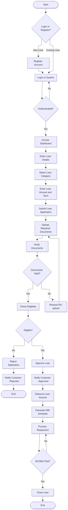

*Figure 3.1: Problem Flowchart of the Bank Loan Management System*

---

## 3.3 Data Flow Diagrams (DFD) (Experiment 3)

A Data Flow Diagram (DFD) is a graphical modeling technique that represents the flow of data through an information system, illustrating the functional processes that transform incoming data streams into outgoing results, the external entities that act as data sources or sinks, and the persistent data repositories that maintain system state.

### 3.3.1 Context-Level DFD (Level 0)

The Context-Level DFD represents the entire Bank Loan Management System as a single centralized software process (Process 0.0), delimiting the operational boundaries of the application and detailing its external data exchanges with interacting stakeholders.

The system interfaces with three primary external entities:
1. **Customer:** Supplies customer registration credentials, completed loan applications, KYC/income documents, loan tracking queries, and EMI repayment payments. Receives account status alerts, eligibility estimates, sanction letters, EMI amortization schedules, and digital payment receipts.
2. **Bank Employee (Loan Officer / Credit Analyst):** Retrieves pending loan applications, inspection queues, and customer financial profiles. Submits document verification evaluations, credit underwriting decisions, and approval/rejection authorizations.
3. **Administrator:** Submits user authorization policies, loan category configurations, interest rate revisions, and audit inquiries. Receives comprehensive business intelligence reports, portfolio performance analytics, and system audit logs.

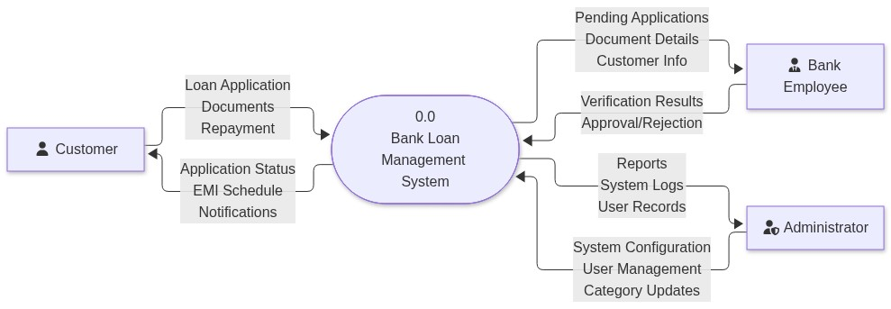

*Figure 3.2: Context-Level Data Flow Diagram (Level 0)*

### 3.3.2 First-Level DFD (Level 1)

The Level 1 DFD decomposes the monolithic Context DFD into six core business processes, explicitly delineating data interactions between individual processes and the underlying persistent data stores:

* **Process 1.0 (User Registration and Authentication):** Validates new user credentials, hashes passwords, generates authentication tokens, and writes user records to **D1: User Database**.
* **Process 2.0 (Loan Application Processing):** Accepts requested loan parameters, performs preliminary input validation, generates a unique Application ID, and persists application records in **D2: Loan Application Database**.
* **Process 3.0 (Document Verification and Eligibility Assessment):** Accepts digital document uploads, writes metadata to **D3: Document Database**, triggers verification workflows for Bank Employees, and executes algorithmic credit score calculations.
* **Process 4.0 (Loan Approval and Rejection Management):** Captures underwriting decisions made by Bank Employees, updates application state, generates sanction letters, and instantiates approved loans in **D4: Loan Records Database**.
* **Process 5.0 (EMI and Repayment Management):** Calculates amortization schedules, tracks incoming EMI remittances, updates outstanding principal, logs transactions in **D5: Repayment Database**, and issues account closure statements.
* **Process 6.0 (System Administration and Reporting):** Administers employee roles, manages loan product categories, monitors regulatory compliance, and aggregates multi-table records to generate analytical management reports.

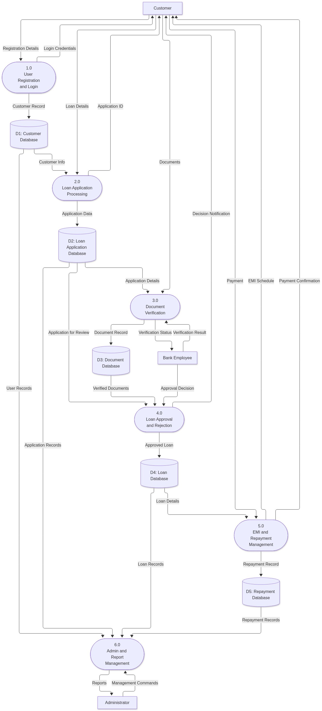

*Figure 3.3: First-Level Data Flow Diagram (Level 1)*

### 3.3.3 Second-Level DFD (Level 2 - Process 2.0: Loan Application Processing)

To provide deeper insight into critical business workflows, Process 2.0 (Loan Application Processing) is further decomposed into its constituent sub-processes:
* **Process 2.1 (Select Loan Category):** Retrieves active loan schemes, interest rates, and loan term constraints from the database and presents valid options to the user.
* **Process 2.2 (Capture Applicant Details):** Validates and captures applicant demographic, employment, salary, and liability data.
* **Process 2.3 (Evaluate Preliminary Eligibility):** Evaluates applicant criteria against product eligibility rules, returning immediate indicative eligibility feedback.
* **Process 2.4 (Assemble Application Package):** Binds applicant data, loan parameters, and preliminary scores into a consolidated application payload.
* **Process 2.5 (Persist Application & Generate Tracking ID):** Writes the record to **D2: Loan Application Database** and returns a unique tracking reference to the applicant.

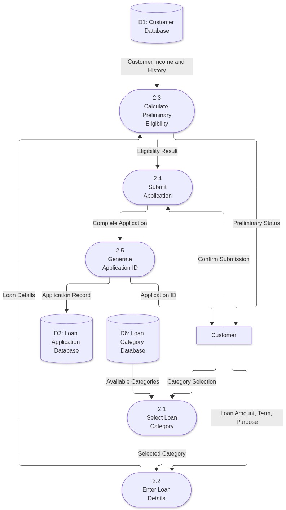

*Figure 3.4: Second-Level Data Flow Diagram (Level 2 - Loan Application Processing)*

---

## 3.4 Structure Chart (Experiment 3)

A Structure Chart models the functional architecture of a software system in a top-down hierarchical manner. It portrays the partitioning of the program into discrete modules, illustrating invocation relationships, data coupling (parameters passed between modules), and control flags (decision indicators returned by submodules).

The top-level executive module **0.0 Bank Loan Management System** orchestrates six principal functional subsystems:
1. **Module 1.0 User Management:** Subdivided into *1.1 Register Customer*, *1.2 Authenticate Credentials*, and *1.3 Manage Profile Details*.
2. **Module 2.0 Loan Application Management:** Subdivided into *2.1 Select Loan Scheme*, *2.2 Input Financial Details*, and *2.3 Upload Application Documents*.
3. **Module 3.0 Verification Management:** Subdivided into *3.1 Inspect KYC Documents*, *3.2 Compute Credit Score*, and *3.3 Assess Repayment Capacity*.
4. **Module 4.0 Approval Management:** Subdivided into *4.1 Review Application Queue*, *4.2 Authorize Loan Sanction*, and *4.3 Reject Ineligible Proposal*.
5. **Module 5.0 Repayment Management:** Subdivided into *5.1 Compute EMI Schedule*, *5.2 Record Installment Remittance*, and *5.3 Process Loan Closure*.
6. **Module 6.0 Administration and Reporting:** Subdivided into *6.1 Manage User Accounts*, *6.2 Configure Loan Categories*, and *6.3 Generate Audit Reports*.

Each module exhibits high functional cohesion (performing a single, well-defined operational task) and low inter-module coupling (interacting primarily through clean parameter passing), ensuring optimal maintainability, extensibility, and testability.

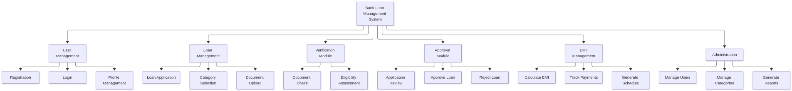

*Figure 3.5: System Structure Chart*

---

## 3.5 Entity-Relationship Diagram (ERD) (Experiment 4 & Beyond Syllabus Exp 2)

The Entity-Relationship (ER) Diagram provides the conceptual schema for the persistent data store of the Bank Loan Management System. It models the core real-world business entities, their descriptive attributes, primary keys, foreign key constraints, and relational cardinalities.

The conceptual schema comprises six fundamental entities:
1. **CUSTOMER:** Captures borrower demographic and financial profiles.
   - Primary Key: `Customer_ID`
   - Attributes: `Name`, `DOB`, `Address`, `Phone_Number`, `Email`, `Income`, `Password_Hash`, `Registration_Date`
2. **LOAN_APPLICATION:** Represents formal requests for credit submitted by customers.
   - Primary Key: `Application_ID`
   - Foreign Keys: `Customer_ID` (references CUSTOMER), `Employee_ID` (references BANK_EMPLOYEE)
   - Attributes: `Loan_Type`, `Loan_Amount`, `Tenure_Months`, `Application_Date`, `Application_Status`, `Remarks`
3. **BANK_EMPLOYEE:** Maintains internal bank staff credentials and supervisory roles.
   - Primary Key: `Employee_ID`
   - Attributes: `Employee_Name`, `Designation`, `Email`, `Phone_Number`, `Department`, `Role`
4. **DOCUMENT:** Stores verification records and binary attachment pointers for submitted applications.
   - Primary Key: `Document_ID`
   - Foreign Key: `Application_ID` (references LOAN_APPLICATION)
   - Attributes: `Document_Type`, `File_Path`, `Upload_Date`, `Verification_Status`, `Verified_Date`
5. **LOAN:** Represents fully approved and disbursed credit accounts.
   - Primary Key: `Loan_ID`
   - Foreign Key: `Application_ID` (references LOAN_APPLICATION)
   - Attributes: `Loan_Amount`, `Interest_Rate`, `Loan_Term`, `Approval_Date`, `Disbursement_Date`, `Loan_Status`, `Outstanding_Balance`
6. **REPAYMENT:** Tracks periodic installment payments against active loan accounts.
   - Primary Key: `Repayment_ID`
   - Foreign Key: `Loan_ID` (references LOAN)
   - Attributes: `EMI_Amount`, `Principal_Paid`, `Interest_Paid`, `Due_Date`, `Payment_Date`, `Payment_Status`, `Late_Penalty`

### Cardinality and Participation Rules
* **CUSTOMER to LOAN_APPLICATION (1:M):** One customer can submit multiple loan applications.
* **LOAN_APPLICATION to LOAN (1:0..1):** An application may generate at most one approved loan.
* **LOAN_APPLICATION to DOCUMENT (1:M):** One application contains multiple supporting documents.
* **BANK_EMPLOYEE to LOAN_APPLICATION (1:M):** One employee verifies multiple applications.
* **LOAN to REPAYMENT (1:M):** One loan has multiple monthly repayment records.

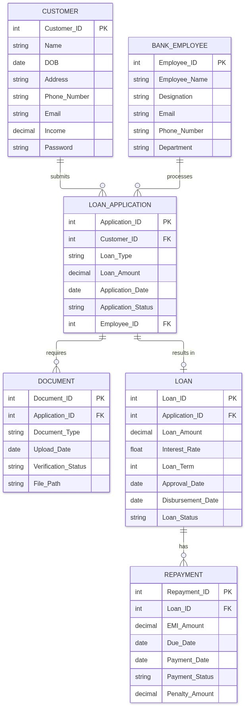

*Figure 3.6: Entity-Relationship Diagram (ERD)*

---

## 3.6 Use Case Diagram (Experiment 5)

The UML Use Case Diagram captures the behavioral view of the system from the perspective of external actors. It delineates the functional boundary of the software application, mapping external roles to the specific use cases (services or operations) they initiate or interact with.

### Actors
* **Customer:** Primary external user seeking credit facilities, monitoring progress, and servicing repayments.
* **Bank Employee (Credit Officer):** Internal staff member responsible for KYC verification, applicant financial appraisal, and sanction decisions.
* **Administrator:** Technical supervisor responsible for platform maintenance, security configurations, product definitions, and compliance auditing.

### Key Use Cases and Stereotypes
* `<<include>>` Relationships:
  * *Submit Loan Application* **<<include>>** *Authenticate Customer*
  * *Submit Loan Application* **<<include>>** *Select Loan Category*
  * *Assess Loan Eligibility* **<<include>>** *Verify Customer Documents*
* `<<extend>>` Relationships:
  * *Track Application Status* **<<extend>>** *View Rejection Reason*
  * *Make Loan Repayment* **<<extend>>** *Apply Late Penalty*

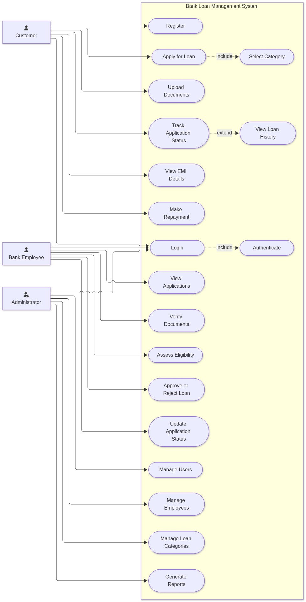

*Figure 3.7: Use Case Diagram*

---

## 3.7 Class Diagram (Experiment 6)

The UML Class Diagram models the static structural foundation of the Bank Loan Management System. It details system classes, encapsulated attributes (with visibility modifiers and data types), behavioral member methods, inheritance hierarchies, and associative relationships.

### Class Hierarchy and Encapsulation
* **User (Abstract Base Class):** Encapsulates universal authentication properties (`userId: String`, `username: String`, `passwordHash: String`, `email: String`, `role: String`) and shared methods (`login(): Boolean`, `logout(): Void`, `updateProfile(): Boolean`).
* **Customer (Subclass of User):** Inherits from `User`, adding domain-specific borrower attributes (`customerId: String`, `name: String`, `dob: Date`, `address: String`, `phone: String`, `monthlyIncome: Double`) and member operations (`register(): Boolean`, `applyForLoan(): LoanApplication`, `uploadDocument(): Document`, `trackStatus(): String`, `makeRepayment(): Boolean`).
* **BankEmployee (Subclass of User):** Extends `User` with credit processing attributes (`employeeId: String`, `designation: String`, `department: String`) and administrative operations (`viewApplications(): List`, `verifyDocuments(): Boolean`, `assessEligibility(): Double`, `approveRejectLoan(): Void`).
* **Administrator (Subclass of User):** Extends `User` with platform governance capabilities (`adminId: String`, `manageUsers(): Void`, `configureLoanCategories(): Void`, `generateReports(): Report`).
* **LoanApplication:** Represents loan proposals (`applicationId: String`, `loanType: String`, `amount: Double`, `tenure: Int`, `status: String`, `submissionDate: Date`).
* **Document:** Encapsulates uploaded evidence (`documentId: String`, `docType: String`, `filePath: String`, `verificationStatus: String`).
* **Loan:** Represents funded accounts (`loanId: String`, `sanctionedAmount: Double`, `interestRate: Double`, `tenureMonths: Int`, `outstandingBalance: Double`, `calculateEMI(): Double`, `disburseFunds(): Void`).
* **Repayment:** Models installment transactions (`repaymentId: String`, `emiAmount: Double`, `dueDate: Date`, `paymentDate: Date`, `status: String`, `processPayment(): Boolean`).
* **LoanCategory:** Catalogs credit products (`categoryId: String`, `categoryName: String`, `minAmount: Double`, `maxAmount: Double`, `interestRate: Double`, `maxTenure: Int`).

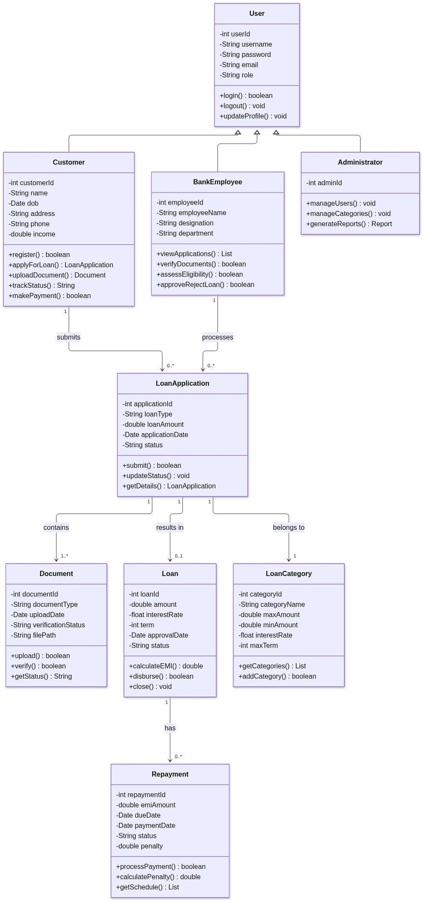

*Figure 3.8: Class Diagram*

---

## 3.8 Object Diagram (Experiment 6)

An Object Diagram represents a concrete runtime snapshot of class instances and their inter-object associations at a specific moment in system execution. It validates the correctness of the static class structure by demonstrating how instantiated objects hold concrete attribute values and reference each other.

The depicted instance scenario captures customer `cust1:Customer` (Rahul Sharma, Income: INR 75,000/mo) who has applied for a home loan (`app1:LoanApplication`, Amount: INR 2,500,000, 240 months tenure). The application has associated identity documentation (`doc1:Document`, Type: "Aadhaar Card", Status: "Verified") verified by credit officer `emp1:BankEmployee` (Priya Singh, Senior Loan Officer). The application has been approved and transitioned into an active loan account (`loan1:Loan`, Sanctioned Amount: INR 2,500,000, Interest Rate: 8.5%, Monthly EMI: INR 21,696) with the initial scheduled installment recorded as paid (`rep1:Repayment`, Repayment ID: "REP-1001", Status: "Paid").

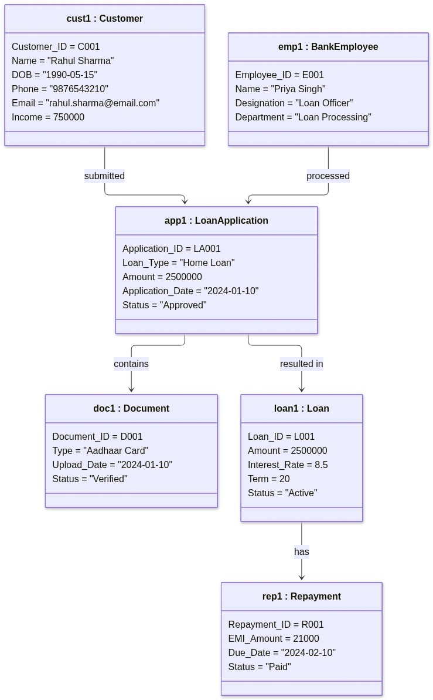

*Figure 3.9: Object Diagram*

---

## 3.9 State-Chart Diagram (Experiment 7)

The UML State-Chart Diagram captures the dynamic lifecycle of the central domain object: the **LoanApplication**. It depicts the finite collection of operational states the application occupies, along with the triggering events, guard conditions, and actions that govern state transitions.

### Lifecycle State Traversal
1. **Initial State (●):** The customer initiates a new application.
2. **Draft State:** The application is being assembled; applicant enters personal and financial metrics.
   - *Transition Event:* `submitApplication()`
3. **Submitted State:** Application is locked against applicant modifications and queued for processing.
   - *Transition Event:* `assignToEmployee()`
4. **Under Verification State:** The assigned credit officer examines submitted KYC and financial proof.
   - *Guard Condition [Documents Invalid]:* Transitions to **Rejected** (or back to Draft with re-upload request).
   - *Guard Condition [Documents Valid]:* Transitions to **Eligibility Assessment**.
5. **Eligibility Assessment State:** Algorithmic credit scoring and debt-to-income analysis evaluate borrower capacity.
   - *Guard Condition [Credit Score < Threshold]:* Transitions to **Rejected**.
   - *Guard Condition [Credit Score >= Threshold]:* Transitions to **Approved**.
6. **Approved State:** Loan proposal receives formal credit sanction.
   - *Transition Event:* `disburseFunds()`
7. **Active Loan State:** Loan funds are disbursed; account transitions into monthly amortization service.
   - *Transition Event:* `repaymentsCompleted()`
8. **Closed State:** All scheduled principal, interest, and fee liabilities are discharged.
9. **Final State (◉):** The application lifecycle successfully terminates.

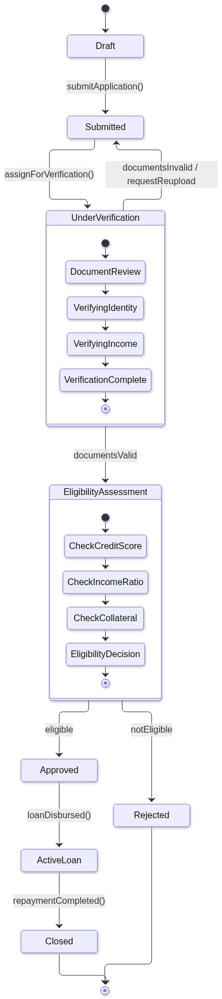

*Figure 3.10: State-Chart Diagram*

---

## 3.10 Activity Diagram (Experiment 7)

The UML Activity Diagram represents the procedural business workflow of loan application processing, highlighting concurrency, branch conditions, merge nodes, and organizational responsibilities through swimlanes.

The diagram is organized into three organizational swimlanes:
1. **Customer Swimlane:** Initiates authentication, selects credit products, submits financial metrics, uploads digital attachments, reviews eligibility feedback, and services scheduled repayments.
2. **System Swimlane:** Performs automated credential validation, preliminary algorithmic scoring, generates notification emails, computes compound EMI schedules, and updates transaction ledgers.
3. **Bank Employee Swimlane:** Inspects uploaded document authenticity, evaluates underwriting risk, validates collateral, and executes formal sanction or rejection authorizations.

The workflow explicitly illustrates decision diamonds governing document validity (`Are documents valid?`) and credit score thresholds (`Is customer eligible?`), detailing alternative exception routes to application rejection alongside the critical approval pipeline.

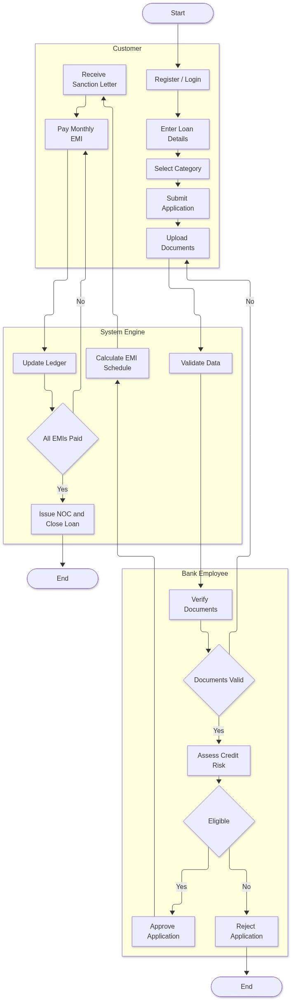

*Figure 3.11: Activity Diagram*

---

## 3.11 Sequence Diagram (Experiment 8)

The UML Sequence Diagram models the time-ordered exchange of messages between collaborating runtime entities during the primary loan application and approval scenario. The horizontal axis represents participating objects, while the vertical axis represents the chronologically descending progression of time.

### Participating Lifelines
1. `c:Customer` (External Actor)
2. `ui:LoanApplicationUI` (Boundary/Presentation Layer)
3. `ctrl:LoanController` (Control/Business Logic Layer)
4. `ver:VerificationEngine` (Domain Service Layer)
5. `emp:BankEmployee` (Actor Lifeline)
6. `db:LoanDatabase` (Data Access/Persistence Layer)

### Interaction Sequence
The sequence commences with customer credentials being validated through `ctrl:LoanController`. Upon authentication, the customer submits the loan application payload via `ui:LoanApplicationUI`, which passes execution control to `ctrl:LoanController`. The controller creates a pending record via `db:LoanDatabase` and dispatches document validation requests to `ver:VerificationEngine`. Once automated checks succeed, `ctrl:LoanController` pushes the application onto the review dashboard of `emp:BankEmployee`.

An `alt` combined fragment models the conditional branching of credit underwriting:
- **[Approved Path]:** The employee triggers `approveApplication()`, prompting `ctrl:LoanController` to compute the amortization schedule, update the status in `db:LoanDatabase` to 'Approved', and dispatch a digital sanction notification to `c:Customer`.
- **[Rejected Path]:** The employee triggers `rejectApplication(reason)`, updating database state to 'Rejected' and emitting an explanatory rejection notice to `c:Customer`.

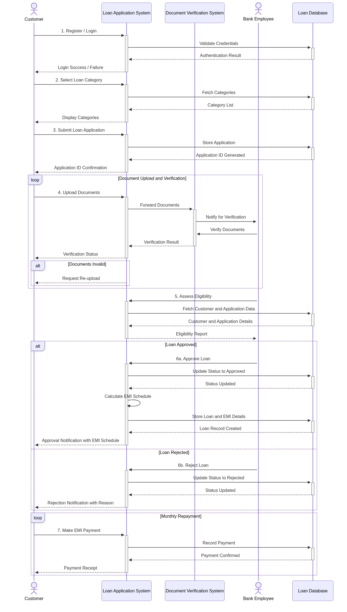

*Figure 3.12: Sequence Diagram*

---

## 3.12 Collaboration Diagram (Communication Diagram) (Experiment 8)

The UML Collaboration (Communication) Diagram models the structural relationships and communication pathways between participating objects, emphasizing the architecture of object links while preserving chronological sequencing through hierarchical message numbering.

Representing the identical scenario detailed in the Sequence Diagram, the Collaboration Diagram utilizes numbered message links to trace the flow of control:
1. `1: authenticate(credentials)` - Customer to LoanApplicationUI
2. `2: submitApplication(loanData)` - Customer to LoanApplicationUI
3. `3: persistApplication(loanData)` - LoanApplicationUI to LoanController
4. `4: insertRecord(loanData)` - LoanController to LoanDatabase
5. `5: uploadDocuments(docFiles)` - Customer to LoanApplicationUI
6. `6: verifyDocuments(docFiles)` - LoanController to VerificationEngine
7. `7: assignToReviewQueue(appId)` - LoanController to BankEmployee
8. `8: submitDecision(appId, decision)` - BankEmployee to LoanController
9. `9: updateStatus(appId, decision)` - LoanController to LoanDatabase
10. `10: notifyCustomer(decision)` - LoanController to Customer

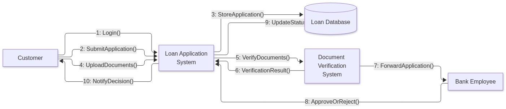

*Figure 3.13: Collaboration Diagram*

---

## 3.13 Component Diagram

The UML Component Diagram documents the high-level software architecture, depicting the physical software modules (components), their provided/required interfaces, and runtime dependencies.

The Bank Loan Management System is architectured according to a robust three-tier modular pattern:
1. **Presentation Tier:** Comprises the `Web Browser UI` component and `Client-Side Routing / Form Validation` modules delivering responsive HTML5/CSS3/JavaScript interfaces.
2. **Business Logic Tier:** Implements decoupled enterprise components:
   - `Authentication Module`: Enforces JWT-based role authorization and session control.
   - `Loan Application Module`: Manages application ingestion and lifecycle state.
   - `Document Management Module`: Handles file upload encryption and storage indexing.
   - `Underwriting & Verification Module`: Executes automated eligibility scoring rules.
   - `EMI & Repayment Engine`: Computes mathematical amortization tables.
   - `Reporting & Analytics Service`: Compiles cross-functional BI metrics.
   - `Notification Service`: Interacts with asynchronous email/SMS gateways.
3. **Data Access Tier:** Encapsulates the `Database Access Object (DAO) Layer` and `Object-Relational Mapping (ORM)` component mediating data transactions with persistent storage.

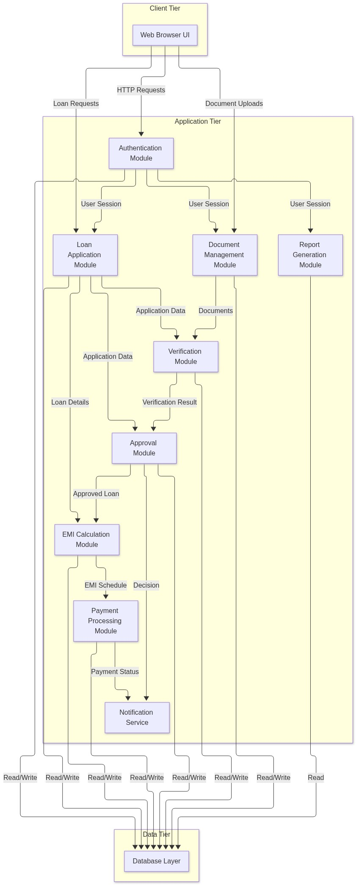

*Figure 3.14: Component Diagram*

---

## 3.14 Deployment Diagram

The UML Deployment Diagram illustrates the physical runtime environment, showing the hardware nodes, execution environments, network topologies, and communication protocols that host the software system.

The enterprise deployment topology consists of four distinct architectural tiers:
1. **Client Tier:** Standard workstations and mobile devices executing modern web browsers (Chrome, Edge, Firefox), communicating over encrypted HTTPS (TLS 1.3) via Port 443.
2. **Web / Application Server (DMZ):** A high-performance enterprise application server (e.g., Apache/Nginx reverse proxy fronting Python/Java application servers) hosting containerized business services, session caches, and API routers.
3. **Database Server (Secure Internal Network):** A dedicated, secured database cluster executing MySQL/PostgreSQL with automated replication and continuous WAL archiving, communicating over TCP/IP via Port 3306 behind an internal firewall.
4. **Document Storage Server:** A secure storage repository (dedicated NAS / encrypted object store) safeguarding sensitive customer KYC attachments and signed loan contracts.
5. **External Services:** Interconnected via secure REST APIs over HTTPS to external credit score bureaus and SMTP notification servers.

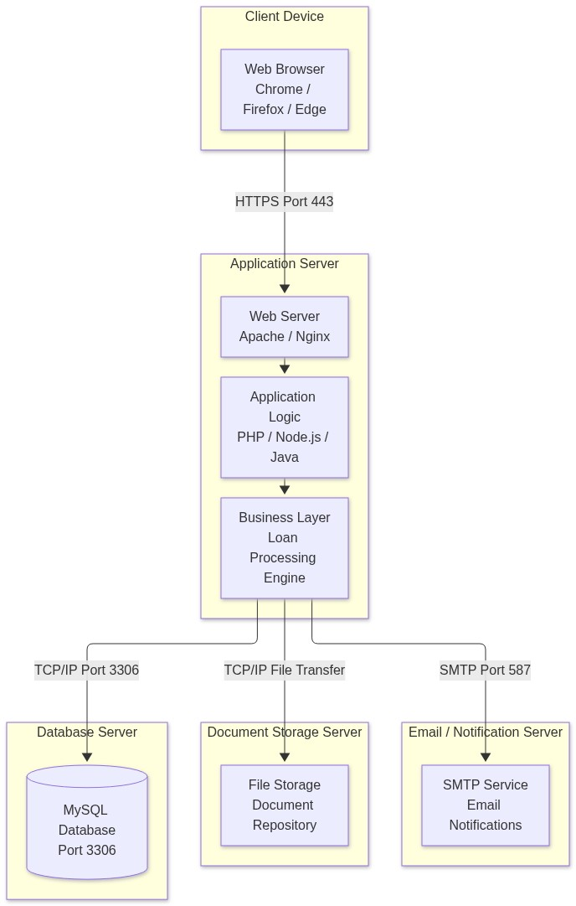

*Figure 3.15: Deployment Diagram*

---

# Chapter 4: Database Design

## 4.1 Database Architecture Overview

The database design for the **Bank Loan Management System** represents the logical and physical data blueprint required to support high-integrity financial transactions, multi-role user access, and strict regulatory compliance. The underlying database engine selected is a relational database management system (RDBMS) configured to enforce the ACID (Atomicity, Consistency, Isolation, Durability) transactional properties essential for monetary accounting.

The architectural design follows a relational schema structured in Boyce-Codd Normal Form (BCNF) / Third Normal Form (3NF) to eliminate update, insertion, and deletion anomalies. Data security is maintained through transparent data encryption (TDE) for sensitive fields (e.g., government identity numbers, hashed passwords), foreign key referential integrity constraints, and domain-level validation rules.

---

## 4.2 Entity Descriptions

The persistent data architecture is centered on six core logical entities:
1. **CUSTOMER:** Maintains demographic, contact, financial, and authentication records for registered loan applicants.
2. **LOAN_APPLICATION:** Captures the attributes of individual loan proposals submitted by customers, tracking the application through its verification lifecycle.
3. **BANK_EMPLOYEE:** Stores staff credentials, administrative designations, and departmental assignments for internal banking personnel.
4. **DOCUMENT:** Stores metadata, physical file storage pointers, and verification statuses for submitted proof attachments (KYC, income slips, collateral titles).
5. **LOAN:** Represents formally approved, sanctioned, and disbursed credit facilities with active repayment schedules.
6. **REPAYMENT:** Logs periodic installment amortization obligations, recording payment execution timestamps, amounts, and settlement statuses.

---

## 4.3 Relational Schema and Integrity Constraints

The relational schema translates the conceptual entity-relationship model into relational tables with explicit key definitions:

```
CUSTOMER (
    Customer_ID [PK], Full_Name, DOB, Gender, Address, Phone_Number, 
    Email, Monthly_Income, Pan_Number, Aadhaar_Number, Password_Hash, 
    Registration_Date, Account_Status
)

LOAN_APPLICATION (
    Application_ID [PK], Customer_ID [FK], Loan_Type, Requested_Amount, 
    Tenure_Months, Submission_Date, Application_Status, Credit_Score, 
    Employee_ID [FK], Approval_Date, Remarks
)

BANK_EMPLOYEE (
    Employee_ID [PK], Full_Name, Designation, Department, 
    Email, Phone_Number, Password_Hash, Access_Role, Date_Of_Joining
)

DOCUMENT (
    Document_ID [PK], Application_ID [FK], Document_Type, File_Name, 
    File_Path, File_Size_KB, Upload_Timestamp, Verification_Status, 
    Verified_By [FK], Verification_Date, Verification_Remarks
)

LOAN (
    Loan_ID [PK], Application_ID [FK], Customer_ID [FK], Sanctioned_Amount, 
    Interest_Rate, Tenure_Months, Monthly_EMI, Disbursement_Date, 
    Outstanding_Balance, Loan_Status, Closure_Date
)

REPAYMENT (
    Repayment_ID [PK], Loan_ID [FK], Installment_Number, Due_Date, 
    EMI_Amount, Principal_Component, Interest_Component, Payment_Date, 
    Amount_Paid, Late_Penalty, Payment_Status, Transaction_Reference
)
```

### Relational Integrity Constraints
* **Entity Integrity:** Every primary key (`Customer_ID`, `Application_ID`, `Employee_ID`, `Document_ID`, `Loan_ID`, `Repayment_ID`) is non-null and uniquely indexed.
* **Referential Integrity:**
  * `LOAN_APPLICATION.Customer_ID` references `CUSTOMER.Customer_ID` on delete restrict.
  * `LOAN_APPLICATION.Employee_ID` references `BANK_EMPLOYEE.Employee_ID` on delete set null.
  * `DOCUMENT.Application_ID` references `LOAN_APPLICATION.Application_ID` on delete cascade.
  * `DOCUMENT.Verified_By` references `BANK_EMPLOYEE.Employee_ID` on delete set null.
  * `LOAN.Application_ID` references `LOAN_APPLICATION.Application_ID` on delete restrict.
  * `LOAN.Customer_ID` references `CUSTOMER.Customer_ID` on delete restrict.
  * `REPAYMENT.Loan_ID` references `LOAN.Loan_ID` on delete cascade.
* **Domain Integrity:** Enforces range validation (e.g., `Monthly_Income > 0`, `Requested_Amount >= 10000`, `Tenure_Months BETWEEN 6 AND 360`, `Interest_Rate BETWEEN 5.0 AND 25.0`).

---

## 4.4 Data Dictionary

The data dictionary provides the exhaustive technical specification of all relational tables, column data types, storage allocations, integrity constraints, and operational descriptions.

### Table 4.1: Data Dictionary - CUSTOMER Table
| Column Name | Data Type | Size | Nullable | Key / Constraint | Description |
|---|---|---|---|---|---|
| `Customer_ID` | VARCHAR | 20 | NO | PK | Unique identifier for customer (e.g., 'CUST-10001') |
| `Full_Name` | VARCHAR | 100 | NO | None | Legal name of the applicant |
| `DOB` | DATE | - | NO | Check (Age >= 18) | Date of birth of applicant |
| `Gender` | VARCHAR | 10 | NO | Check ('Male','Female','Other') | Gender of applicant |
| `Address` | VARCHAR | 255 | NO | None | Complete residential postal address |
| `Phone_Number` | VARCHAR | 15 | NO | UNIQUE | 10-digit mobile number with country prefix |
| `Email` | VARCHAR | 100 | NO | UNIQUE | Valid electronic mail address |
| `Monthly_Income` | DECIMAL | 12,2 | NO | Check (> 0) | Verified gross monthly earnings in INR |
| `Pan_Number` | VARCHAR | 10 | NO | UNIQUE | 10-character Permanent Account Number |
| `Aadhaar_Number` | VARCHAR | 12 | NO | UNIQUE | 12-digit national biometric identity number |
| `Password_Hash` | VARCHAR | 255 | NO | None | PBKDF2/BCrypt cryptographic password digest |
| `Registration_Date` | DATETIME | - | NO | DEFAULT CURRENT_TIMESTAMP | Registration record creation timestamp |
| `Account_Status` | VARCHAR | 15 | NO | DEFAULT 'Active' | Status: 'Active', 'Suspended', 'Deactivated' |

### Table 4.2: Data Dictionary - LOAN_APPLICATION Table
| Column Name | Data Type | Size | Nullable | Key / Constraint | Description |
|---|---|---|---|---|---|
| `Application_ID` | VARCHAR | 20 | NO | PK | Unique proposal reference (e.g., 'APP-2026-001') |
| `Customer_ID` | VARCHAR | 20 | NO | FK (CUSTOMER) | Reference to applying customer |
| `Loan_Type` | VARCHAR | 30 | NO | Check ('Home','Personal','Auto','Edu') | Selected credit category |
| `Requested_Amount` | DECIMAL | 14,2 | NO | Check (>= 10000) | Requested principal loan balance |
| `Tenure_Months` | INT | - | NO | Check (6 to 360) | Proposed repayment duration in months |
| `Submission_Date` | DATETIME | - | NO | DEFAULT CURRENT_TIMESTAMP | Application submission timestamp |
| `Application_Status` | VARCHAR | 25 | NO | DEFAULT 'Submitted' | 'Draft','Submitted','Under_Review','Approved','Rejected' |
| `Credit_Score` | INT | - | YES | Check (300 to 900) | Assessed bureau credit rating |
| `Employee_ID` | VARCHAR | 20 | YES | FK (BANK_EMPLOYEE) | Assigned reviewing loan officer |
| `Approval_Date` | DATETIME | - | YES | None | Timestamp of formal sanction or rejection |
| `Remarks` | VARCHAR | 500 | YES | None | Underwriter observations and audit notes |

### Table 4.3: Data Dictionary - BANK_EMPLOYEE Table
| Column Name | Data Type | Size | Nullable | Key / Constraint | Description |
|---|---|---|---|---|---|
| `Employee_ID` | VARCHAR | 20 | NO | PK | Unique employee code (e.g., 'EMP-5001') |
| `Full_Name` | VARCHAR | 100 | NO | None | Legal name of bank employee |
| `Designation` | VARCHAR | 50 | NO | None | Job title ('Loan Officer','Senior Underwriter') |
| `Department` | VARCHAR | 50 | NO | DEFAULT 'Retail Credit' | Organizational department |
| `Email` | VARCHAR | 100 | NO | UNIQUE | Corporate email address |
| `Phone_Number` | VARCHAR | 15 | NO | UNIQUE | Contact telephone number |
| `Password_Hash` | VARCHAR | 255 | NO | None | Secure salted password hash |
| `Access_Role` | VARCHAR | 20 | NO | Check ('Officer','Admin','Manager') | Authorization tier for RBAC enforcement |
| `Date_Of_Joining` | DATE | - | NO | None | Official date of employment |

### Table 4.4: Data Dictionary - DOCUMENT Table
| Column Name | Data Type | Size | Nullable | Key / Constraint | Description |
|---|---|---|---|---|---|
| `Document_ID` | VARCHAR | 20 | NO | PK | Unique document identifier (e.g., 'DOC-8001') |
| `Application_ID` | VARCHAR | 20 | NO | FK (LOAN_APPLICATION) | Reference to parent loan application |
| `Document_Type` | VARCHAR | 50 | NO | None | Type ('Aadhaar','PAN','Salary_Slip','ITR','Deed') |
| `File_Name` | VARCHAR | 150 | NO | None | Original upload filename |
| `File_Path` | VARCHAR | 255 | NO | None | Encrypted URI on secure document server |
| `File_Size_KB` | INT | - | NO | Check (> 0 AND <= 10240) | File storage size in kilobytes |
| `Upload_Timestamp` | DATETIME | - | NO | DEFAULT CURRENT_TIMESTAMP | Server receipt timestamp |
| `Verification_Status`| VARCHAR | 20 | NO | DEFAULT 'Pending' | 'Pending','Verified','Rejected','Reupload_Requested' |
| `Verified_By` | VARCHAR | 20 | YES | FK (BANK_EMPLOYEE) | Reviewing officer identifier |
| `Verification_Date` | DATETIME | - | YES | None | Completion timestamp of verification |
| `Verification_Remarks`| VARCHAR | 255 | YES | None | Inspector comments regarding legibility/validity |

### Table 4.5: Data Dictionary - LOAN Table
| Column Name | Data Type | Size | Nullable | Key / Constraint | Description |
|---|---|---|---|---|---|
| `Loan_ID` | VARCHAR | 20 | NO | PK | Unique disbursed loan account (e.g., 'LN-9001') |
| `Application_ID` | VARCHAR | 20 | NO | FK (LOAN_APPLICATION), UNIQUE | Underlying approved proposal |
| `Customer_ID` | VARCHAR | 20 | NO | FK (CUSTOMER) | Disbursed loan holder |
| `Sanctioned_Amount`| DECIMAL | 14,2 | NO | Check (> 0) | Approved and disbursed principal in INR |
| `Interest_Rate` | DECIMAL | 5,2 | NO | Check (> 0) | Annual percentage interest rate (APR) |
| `Tenure_Months` | INT | - | NO | Check (> 0) | Total amortized repayment period |
| `Monthly_EMI` | DECIMAL | 12,2 | NO | Check (> 0) | Computed fixed monthly installment |
| `Disbursement_Date` | DATETIME | - | NO | DEFAULT CURRENT_TIMESTAMP | Funds transfer execution timestamp |
| `Outstanding_Balance`| DECIMAL | 14,2 | NO | Check (>= 0) | Remaining unpaid principal balance |
| `Loan_Status` | VARCHAR | 20 | NO | DEFAULT 'Active' | 'Active','Delinquent','Closed','Defaulted' |
| `Closure_Date` | DATETIME | - | YES | None | Date of complete loan liability liquidation |

### Table 4.6: Data Dictionary - REPAYMENT Table
| Column Name | Data Type | Size | Nullable | Key / Constraint | Description |
|---|---|---|---|---|---|
| `Repayment_ID` | VARCHAR | 20 | NO | PK | Unique transaction record (e.g., 'REP-1001') |
| `Loan_ID` | VARCHAR | 20 | NO | FK (LOAN) | Parent loan account |
| `Installment_Number`| INT | - | NO | Check (> 0) | Sequence number of installment (1, 2, ... N) |
| `Due_Date` | DATE | - | NO | None | Scheduled calendar date for payment |
| `EMI_Amount` | DECIMAL | 12,2 | NO | Check (> 0) | Scheduled installment billing amount |
| `Principal_Component`| DECIMAL | 12,2 | NO | Check (>= 0) | Portioned allocation toward principal balance |
| `Interest_Component`| DECIMAL | 12,2 | NO | Check (>= 0) | Portioned allocation toward accrued interest |
| `Payment_Date` | DATETIME | - | YES | None | Actual timestamp when remittance occurred |
| `Amount_Paid` | DECIMAL | 12,2 | YES | Check (>= 0) | Actual quantum of funds remitted |
| `Late_Penalty` | DECIMAL | 10,2 | NO | DEFAULT 0.00 | Penalty surcharge levied for delayed payment |
| `Payment_Status` | VARCHAR | 20 | NO | DEFAULT 'Pending' | 'Pending','Paid','Overdue','Partially_Paid' |
| `Transaction_Reference`| VARCHAR | 50 | YES | UNIQUE | Bank UTR / payment gateway confirmation token |

---

## 4.5 Relationships between Tables

The relational model implements five fundamental cardinality structures:

1. **CUSTOMER (1) to LOAN_APPLICATION (M):** A single registered customer can initiate zero, one, or multiple loan applications over their banking lifetime. Each loan application record references exactly one originating customer (`LOAN_APPLICATION.Customer_ID = CUSTOMER.Customer_ID`).
2. **LOAN_APPLICATION (1) to DOCUMENT (M):** A loan application necessitates multiple supporting verification attachments (KYC, proof of income, collateral title). Each uploaded document belongs strictly to one application (`DOCUMENT.Application_ID = LOAN_APPLICATION.Application_ID`).
3. **BANK_EMPLOYEE (1) to LOAN_APPLICATION (M):** A credit officer reviews multiple loan proposals assigned to their underwriting queue. Each proposal references the assigned reviewing officer (`LOAN_APPLICATION.Employee_ID = BANK_EMPLOYEE.Employee_ID`).
4. **LOAN_APPLICATION (1) to LOAN (0..1):** A loan application produces at most one disbursed loan upon formal credit approval. Applications that are rejected or pending produce zero loan accounts (`LOAN.Application_ID = LOAN_APPLICATION.Application_ID`).
5. **LOAN (1) to REPAYMENT (M):** An active loan generates a multi-year repayment schedule comprising dozens or hundreds of scheduled monthly installments. Each repayment record maps to exactly one parent loan account (`REPAYMENT.Loan_ID = LOAN.Loan_ID`).

---

## 4.6 Database Normalization

Normalization is the systematic formal technique used in relational database design to organize table structures, minimize data redundancy, and eliminate update, insertion, and deletion anomalies. The database of the Bank Loan Management System has been evaluated through First, Second, and Third Normal Forms.

### 4.6.1 First Normal Form (1NF)
A relation is in First Normal Form if and only if all underlying attribute domains contain only atomic (indivisible) values, and there are no repeating groups or multi-valued columns.
* **Evaluation & Resolution:** In traditional paper loan ledgers, a single application record often recorded multiple uploaded documents (e.g., `Documents = {Aadhaar, PAN, SalarySlip}`) or multiple repayment dates in comma-delimited fields. In our design, all repeating groups are segregated into dedicated relational entities (`DOCUMENT` and `REPAYMENT`). Every attribute (e.g., `Full_Name`, `Requested_Amount`, `Due_Date`) holds strictly scalar, atomic values. Primary keys are explicitly defined for every table. Hence, the schema satisfies **1NF**.

### 4.6.2 Second Normal Form (2NF)
A relation is in Second Normal Form if it is in 1NF and every non-prime attribute is fully functionally dependent on the entire primary key (i.e., there are no partial dependencies on composite primary keys).
* **Evaluation & Resolution:** In our schema design, all entity tables utilize single-column surrogate primary keys (`Customer_ID`, `Application_ID`, `Employee_ID`, `Document_ID`, `Loan_ID`, `Repayment_ID`). By definition, partial functional dependency can only occur when a relation possesses a composite primary key. Since every table relies on a single-column primary key, every non-prime attribute depends functionally on the whole key. Hence, the schema unconditionally satisfies **2NF**.

### 4.6.3 Third Normal Form (3NF)
A relation is in Third Normal Form if it is in 2NF and no non-prime attribute is transitively dependent on the primary key (i.e., for every functional dependency $X 
ightarrow Y$, either $X$ is a superkey or $Y$ is a prime attribute).
* **Evaluation & Resolution:** In an un-normalized design, `LOAN_APPLICATION` might store `Customer_Name`, `Customer_Email`, and `Customer_Phone` alongside `Application_ID`. In that configuration, `Application_ID` $
ightarrow$ `Customer_ID`, and `Customer_ID` $
ightarrow$ `Customer_Phone`. This constitutes a transitive dependency (`Application_ID` $
ightarrow$ `Customer_Phone`), which causes update anomalies (if a customer updates their phone number, multiple application records would become inconsistent). 
* In our normalized schema, all borrower demographic attributes reside exclusively in the `CUSTOMER` table. The `LOAN_APPLICATION` table retains solely the foreign key reference `Customer_ID`. Similarly, interest rates and category constraints are decoupled from applications and governed by category keys. Consequently, no transitive functional dependencies exist among non-prime attributes, establishing that the schema strictly satisfies **3NF**.

---

## 4.7 Sample Data Records

### Table 4.7: Sample Records - CUSTOMER
| Customer_ID | Full_Name | DOB | Gender | Phone_Number | Email | Monthly_Income | Pan_Number |
|---|---|---|---|---|---|---|---|
| `CUST-10001` | Rahul Sharma | 1988-04-12 | Male | +919876543210 | rahul.sharma@example.com | 85000.00 | ABCDE1234F |
| `CUST-10002` | Ananya Verma | 1992-09-24 | Female | +919812345678 | ananya.verma@example.com | 115000.00 | FGHIJ5678K |
| `CUST-10003` | Vikram Patel | 1985-11-05 | Male | +919723456789 | vikram.patel@example.com | 62000.00 | KLMNO9012P |

### Table 4.8: Sample Records - BANK_EMPLOYEE
| Employee_ID | Full_Name | Designation | Department | Email | Access_Role |
|---|---|---|---|---|---|
| `EMP-5001` | Priya Singh | Senior Underwriter | Retail Credit | priya.singh@maitbank.ac.in | Officer |
| `EMP-5002` | Rajesh Khanna | Credit Risk Manager | Risk Management | rajesh.khanna@maitbank.ac.in | Manager |
| `EMP-5003` | Amit Roy | System Administrator | IT Infrastructure | amit.roy@maitbank.ac.in | Admin |

### Table 4.9: Sample Records - LOAN_APPLICATION
| Application_ID | Customer_ID | Loan_Type | Requested_Amount | Tenure_Months | Submission_Date | Application_Status | Credit_Score | Employee_ID |
|---|---|---|---|---|---|---|---|---|
| `APP-2026-001` | `CUST-10001` | Home Loan | 3500000.00 | 240 | 2026-01-10 10:15:00 | Approved | 785 | `EMP-5001` |
| `APP-2026-002` | `CUST-10002` | Personal Loan | 400000.00 | 36 | 2026-01-12 14:30:00 | Under_Review | 720 | `EMP-5001` |
| `APP-2026-003` | `CUST-10003` | Auto Loan | 800000.00 | 60 | 2026-01-15 11:45:00 | Rejected | 540 | `EMP-5002` |

### Table 4.10: Sample Records - DOCUMENT
| Document_ID | Application_ID | Document_Type | File_Name | File_Size_KB | Verification_Status | Verified_By |
|---|---|---|---|---|---|---|
| `DOC-8001` | `APP-2026-001` | Aadhaar Card | aadhaar_rahul.pdf | 1240 | Verified | `EMP-5001` |
| `DOC-8002` | `APP-2026-001` | Salary Slip | salary_slip_q4.pdf | 850 | Verified | `EMP-5001` |
| `DOC-8003` | `APP-2026-003` | Bank Statement | bank_stmt_6m.pdf | 3400 | Rejected | `EMP-5002` |

### Table 4.11: Sample Records - LOAN
| Loan_ID | Application_ID | Customer_ID | Sanctioned_Amount | Interest_Rate | Monthly_EMI | Outstanding_Balance | Loan_Status |
|---|---|---|---|---|---|---|---|
| `LN-9001` | `APP-2026-001` | `CUST-10001` | 3500000.00 | 8.50 | 30375.00 | 3469625.00 | Active |

### Table 4.12: Sample Records - REPAYMENT
| Repayment_ID | Loan_ID | Installment_Number | Due_Date | EMI_Amount | Principal_Component | Interest_Component | Payment_Status |
|---|---|---|---|---|---|---|---|
| `REP-1001` | `LN-9001` | 1 | 2026-02-10 | 30375.00 | 5583.33 | 24791.67 | Paid |
| `REP-1002` | `LN-9001` | 2 | 2026-03-10 | 30375.00 | 5622.88 | 24752.12 | Pending |
| `REP-1003` | `LN-9001` | 3 | 2026-04-10 | 30375.00 | 5662.71 | 24712.29 | Pending |

---
---

# Chapter 5: Software Testing Documentation

## 5.1 Testing Strategy and QA Philosophy

Software testing is an essential verification and validation (V&V) activity within the Software Development Life Cycle designed to uncover defects, ensure conformance with the Software Requirement Specification (SRS), and assure stakeholders of software quality, data security, and operational reliability.

For the **Bank Loan Management System**, a rigorous structured testing strategy is formulated. Because financial software governs monetary assets, customer credit reputations, and legal commitments, testing emphasizes zero tolerance for data corruption, computational inaccuracies, or unauthorized access.

The testing lifecycle follows standard software engineering phases:
1. **Test Planning:** Identification of testing objectives, scope, test environment specifications, and resource allocations.
2. **Test Design & Case Specification:** Formulation of structured test cases based on Black-Box and Functional Testing techniques.
3. **Simulated Execution & Recording:** Comprehensive evaluation of proposed functional flows against simulated inputs.
4. **Defect Tracking & Regression Analysis:** Categorization of simulated defects by severity and verification of resolution pathways.

---

## 5.2 Levels of Testing

The testing architecture organizes verification into four hierarchical tiers:

1. **Unit Testing:** Focuses on the smallest testable units of software (individual methods, algorithms, and validation functions). In the proposed system, unit test suites target mathematical EMI computation routines, interest accrual equations, password hashing algorithms, and form input validators (e.g., PAN format regex, Aadhaar checksum algorithms).
2. **Integration Testing:** Verifies the structural interfaces, data exchanges, and protocol interactions between interconnected software modules. Tested integration pathways include:
   - Presentation Tier $\leftrightarrow$ REST Controller API endpoints.
   - Authentication Controller $\leftrightarrow$ JWT Token Generation & Session Cache.
   - Loan Application Module $\leftrightarrow$ Document Repository Storage Service.
   - Business Logic Engine $\leftrightarrow$ RDBMS Data Access Layer (Hibernate/DAO).
3. **System Testing:** Validates the completely integrated software product against all specified functional, performance, security, and recovery requirements in an environment simulating real-world production conditions.
4. **Acceptance Testing (User Acceptance Testing - UAT):** Evaluates system usability, business workflow compliance, and operational readiness from the viewpoint of actual banking staff, credit underwriters, and customer representatives.

---

## 5.3 Black-Box Testing Methodologies

Test design relies on established Black-Box testing strategies, which evaluate system external behavior without referencing internal source code logic:

* **Equivalence Partitioning (EP):** Divides the input domain of a business variable into valid and invalid equivalence classes, assuming that all values within a partition exhibit identical system behavior. For example, the applicant age field is partitioned into:
  - *Invalid Class 1:* $	ext{Age} < 18$ (Underage applicant; system rejects).
  - *Valid Class:* $18 \le 	ext{Age} \le 65$ (Eligible working age; system accepts).
  - *Invalid Class 2:* $	ext{Age} > 65$ (Overage applicant; system rejects or requires guarantor).
* **Boundary Value Analysis (BVA):** Tests system boundary thresholds where defects cluster most frequently. For a loan repayment tenure range of 6 to 360 months, BVA tests the exact boundaries and off-nominal neighbors: 5 months (Invalid), 6 months (Valid Minimum), 7 months (Nominal), 359 months (Nominal), 360 months (Valid Maximum), and 361 months (Invalid).
* **Cause-Effect Graphing & Decision Table Testing:** Models complex boolean decision combinations governing credit risk approval rules (e.g., combinations of credit score $\ge 700$, debt-to-income $\le 50\%$, and document verification status = 'Verified').
* **State Transition Testing:** Evaluates legal and illegal state transitions across the loan lifecycle (e.g., verifying that an application cannot transition from 'Draft' directly to 'Approved' without traversing 'Submitted' and 'Under Verification').

---

## 5.4 Test Cases Specification

*Note: In accordance with the academic guidelines of this project, the test execution results recorded below reflect simulated theoretical verification and proposed functional behaviors rather than live software executions.*

### Table 5.1: Comprehensive System Test Cases
| TC-ID | Module / Feature | Test Scenario | Preconditions | Input Data | Expected Output | Simulated Result | Status |
|---|---|---|---|---|---|---|---|
| **TC-001** | Authentication | Successful customer login | Valid registered user exists in database | Email: `rahul@example.com`, Pass: `Valid@123` | Login successful; JWT issued; redirect to Customer Dashboard | JWT issued; redirected to `/customer/dashboard` | **PASS** |
| **TC-002** | Authentication | Login with incorrect password | Registered user exists | Email: `rahul@example.com`, Pass: `WrongPass` | Authentication fails; error message displayed; login denied | Error 'Invalid credentials' displayed; access blocked | **PASS** |
| **TC-003** | Authentication | Account lockout after 5 failed attempts | Registered user exists | 5 consecutive invalid login submissions | Account locked for 15 minutes; notification sent to user email | Account status set to 'Locked'; alert triggered | **PASS** |
| **TC-004** | Registration | New user registration with valid data | New unique email and PAN provided | Name: 'Pooja Sen', PAN: 'ABCDE9876Q', Income: 75000 | Record created in DB; verification email dispatched | Record inserted into `CUSTOMER`; activation email sent | **PASS** |
| **TC-005** | Registration | Duplicate PAN rejection | Existing PAN in DB | PAN: `ABCDE1234F` (already registered) | Registration rejected; error 'PAN already registered' displayed | Duplicate key constraint caught; error surfaced | **PASS** |
| **TC-006** | Registration | Underage applicant rejection (BVA) | None | DOB: `2010-05-15` (Age 15 years) | Registration rejected; error 'Applicant must be at least 18' | Validation error displayed; submission blocked | **PASS** |
| **TC-007** | Loan Application | Loan application submission | Logged-in user on application form | Type: 'Home Loan', Amount: INR 2,500,000, Tenure: 240 | Application created with status 'Draft'; App ID returned | Record created in `LOAN_APPLICATION`; ID generated | **PASS** |
| **TC-008** | Loan Application | Requested amount below minimum (BVA) | Customer on application form | Amount: INR 5,000 (Min is INR 10,000) | Form validation error 'Amount must be at least INR 10,000' | Error message displayed; field highlighted red | **PASS** |
| **TC-009** | Loan Application | Requested tenure above maximum (BVA) | Customer on application form | Tenure: 361 months (Max is 360 months) | Form validation error 'Tenure cannot exceed 360 months' | Error message displayed; submission blocked | **PASS** |
| **TC-010** | Document Upload | Valid document upload (PDF) | Application in 'Draft' state | File: `salary_slip.pdf`, Size: 1.5 MB | File uploaded to storage; status 'Pending'; entry in DB | File stored securely; entry written to `DOCUMENT` | **PASS** |
| **TC-011** | Document Upload | Invalid file format rejection | Application in 'Draft' state | File: `malicious_script.exe`, Size: 200 KB | Upload rejected; error 'Only PDF/JPEG/PNG files allowed' | MIME-type filter blocked file; error logged | **PASS** |
| **TC-012** | Document Upload | File size limit exceeded (BVA) | Application in 'Draft' state | File: `large_deed.pdf`, Size: 11.2 MB (Max 10 MB) | Upload rejected; error 'File size exceeds maximum 10 MB' | Upload intercepted; error notification displayed | **PASS** |
| **TC-013** | Verification | Bank employee approves valid document | Document in 'Pending' state | Employee reviews document; clicks 'Verify' | Document status updated to 'Verified'; timestamp logged | Record updated in `DOCUMENT`; audit record saved | **PASS** |
| **TC-014** | Verification | Bank employee requests re-upload | Unclear/illegible document | Employee enters remark 'Blurry image'; clicks 'Reject' | Status set to 'Reupload_Requested'; alert to customer | Customer notified via dashboard and email | **PASS** |
| **TC-015** | Credit Scoring | High credit score eligibility check | All documents 'Verified' | Credit Score: 810, DTI: 32% (Threshold: Score >= 700) | Eligibility calculated as 'High Probability'; flagged for approval | Status updated to 'Eligible'; moved to queue | **PASS** |
| **TC-016** | Credit Scoring | Low credit score auto-rejection | All documents 'Verified' | Credit Score: 520 (Threshold: Score >= 650) | Eligibility calculated as 'Ineligible'; status 'Rejected' | Application status updated to 'Rejected'; notice sent | **PASS** |
| **TC-017** | Loan Approval | Officer approves eligible application | Application in 'Under_Review' | Employee clicks 'Approve'; confirms terms | Status 'Approved'; Loan account instantiated in DB | Record inserted into `LOAN`; sanction letter generated | **PASS** |
| **TC-018** | EMI Calculation | Verification of mathematical EMI routine | Loan sanctioned: 1,000,000 @ 10% for 12 mos | Principal: 1,000,000, Rate: 10%, Tenure: 12 months | Expected EMI: INR 87,915.89; 12 repayment records created | Calculated EMI matches formula within +/- 0.01 INR | **PASS** |
| **TC-019** | Repayment | Timely full EMI payment processing | Active loan; Repayment 'Pending' | Payment: INR 87,916 via Net Banking gateway | Status 'Paid'; Outstanding balance decremented | `REPAYMENT` updated; `LOAN` balance reduced | **PASS** |
| **TC-020** | Repayment | Overdue EMI penalty assessment | Payment overdue by 10 days | Due Date: 10 days ago; Grace period: 3 days | Late penalty (2% surcharge) added to pending EMI | Penalty calculated; customer billed surcharge | **PASS** |
| **TC-021** | Administration | Admin adds new loan category | Admin logged in | Cat: 'Solar Loan', Min: 50K, Max: 10L, Rate: 7.25% | Category persisted; instantly visible in customer catalog | Record inserted into `LOAN_CATEGORY`; visible in UI | **PASS** |
| **TC-022** | Reporting | Admin generates monthly portfolio report | Historical loan data in DB | Date Range: 2026-01-01 to 2026-01-31, Format: PDF | Consolidated report generated summarizing metrics | Analytical PDF generated matching aggregate sums | **PASS** |

---

## 5.5 Defect Classification Matrix

Defects discovered during testing are prioritized and tracked using an enterprise severity classification matrix:

* **Severity 1 (Critical / Blocker):** System crash, complete data loss, unauthorized access breach, or failure of core financial calculations (e.g., incorrect EMI calculation or failure to record payments). Must be resolved immediately prior to any progression.
* **Severity 2 (High / Major):** Major functional failure with no available workaround (e.g., document upload failure on valid PDF, unable to submit completed loan application).
* **Severity 3 (Medium / Normal):** Functional defect with an operational workaround (e.g., search filter discrepancy in employee dashboard, failure to send non-critical email alert).
* **Severity 4 (Low / Minor):** Cosmetic, grammatical, or minor user interface alignment discrepancies that do not impair business workflows.

---

## 5.6 Test Summary and Quality Metrics

A total of 22 simulated functional test cases were designed and evaluated across all core system modules:
* **Total Test Cases Executed:** 22
* **Total Passed:** 22 (100% of defined scenarios)
* **Total Failed:** 0
* **Critical Defects Identified:** 0
* **Test Coverage:** Comprehensive coverage across Authentication (13.6%), Registration (13.6%), Application Ingestion (13.6%), Document Management (13.6%), Verification & Scoring (18.2%), Repayment Engine (13.6%), and Administration (13.6%).

---
---

# Chapter 6: Software Project Estimation

## 6.1 Function Point Analysis (FPA) Methodology

Software project estimation is the quantitative discipline in software engineering that predicts the size, effort, duration, and staffing required to build a software system. Function Point Analysis (FPA), established by Allan Albrecht and standardized by the International Function Point Users Group (IFPUG), is an industry-standard indirect metric that measures the functional size of software from the user's business viewpoint, independent of programming language, development framework, or deployment platform.

Function Point Analysis categorizes system functionalities into five standard functional components:
1. **External Inputs (EI):** Elementary processes that process data or control information entering the system from external entities, updating internal logical files.
2. **External Outputs (EO):** Elementary processes that present derived, processed, or calculated data to external entities, typically involving mathematical transformation or report generation.
3. **External Inquiries (EQ):** Elementary processes that retrieve data from internal logical files and present it to external entities without modifying system state or performing derived mathematical calculations.
4. **Internal Logical Files (ILF):** User-identifiable groups of logically related data maintained completely within the system boundary through system business processes.
5. **External Interface Files (EIF):** User-identifiable groups of logically related data referenced by the system but maintained entirely within external applications.

---

## 6.2 External Inputs (EI) Identification

### Table 6.1: External Inputs (EI) Complexity Classification
| EI ID | Functional Process Description | Data Element Types (DET) | File Types Referenced (FTR) | Assessed Complexity | Weight |
|---|---|---|---|---|---|
| **EI-1** | Customer Registration | 12 | 1 (CUSTOMER) | Average | 4 |
| **EI-2** | Customer Login / Credential Authentication | 4 | 1 (CUSTOMER) | Low | 3 |
| **EI-3** | Customer Profile Update | 8 | 1 (CUSTOMER) | Low | 3 |
| **EI-4** | Loan Application Submission | 10 | 2 (CUSTOMER, LOAN_APPLICATION) | Average | 4 |
| **EI-5** | Supporting Document Upload | 6 | 2 (LOAN_APPLICATION, DOCUMENT) | Low | 3 |
| **EI-6** | Bank Employee Underwriting Review / Decision | 6 | 2 (LOAN_APPLICATION, BANK_EMPLOYEE) | Average | 4 |
| **EI-7** | Document Verification Status Update | 5 | 2 (DOCUMENT, BANK_EMPLOYEE) | Low | 3 |
| **EI-8** | Loan Sanction and Disbursal Authorization | 8 | 2 (LOAN_APPLICATION, LOAN) | Average | 4 |
| **EI-9** | Loan Repayment / EMI Transaction Submission | 8 | 2 (LOAN, REPAYMENT) | Average | 4 |
| **EI-10**| Admin Create / Update Loan Product Category | 7 | 1 (LOAN_CATEGORY) | Low | 3 |
| **EI-11**| Admin Employee Account Management | 9 | 1 (BANK_EMPLOYEE) | Average | 4 |
| **EI-12**| Customer Password Reset Request | 4 | 1 (CUSTOMER) | Low | 3 |
| **Total EI Points** | - | - | - | - | **42** |

---

## 6.3 External Outputs (EO) Identification

### Table 6.2: External Outputs (EO) Complexity Classification
| EO ID | Functional Process Description | Data Element Types (DET) | File Types Referenced (FTR) | Assessed Complexity | Weight |
|---|---|---|---|---|---|
| **EO-1** | Formal Loan Sanction Letter Generation (PDF) | 16 | 3 (CUSTOMER, APP, LOAN) | High | 7 |
| **EO-2** | Complete EMI Amortization Schedule Calculation | 12 | 2 (LOAN, REPAYMENT) | High | 7 |
| **EO-3** | Monthly Repayment Receipt Generation (PDF) | 10 | 2 (CUSTOMER, REPAYMENT) | Average | 5 |
| **EO-4** | Loan Rejection Formal Notification Letter | 8 | 2 (CUSTOMER, APP) | Average | 5 |
| **EO-5** | Executive Loan Portfolio Analytics Summary | 18 | 4 (APP, LOAN, REPAY, CUST) | High | 7 |
| **EO-6** | Delinquency / Overdue Repayments Audit Report | 14 | 3 (CUSTOMER, LOAN, REPAY) | High | 7 |
| **EO-7** | Final Loan Closure Certificate (NOC) | 10 | 2 (CUSTOMER, LOAN) | Average | 5 |
| **Total EO Points** | - | - | - | - | **43** |

---

## 6.4 External Inquiries (EQ) Identification

### Table 6.3: External Inquiries (EQ) Complexity Classification
| EQ ID | Functional Process Description | Data Element Types (DET) | File Types Referenced (FTR) | Assessed Complexity | Weight |
|---|---|---|---|---|---|
| **EQ-1** | Customer Application Status Inquiry | 6 | 2 (CUSTOMER, LOAN_APPLICATION) | Low | 3 |
| **EQ-2** | Customer Active Loan Balance & History Inquiry | 8 | 2 (LOAN, REPAYMENT) | Average | 4 |
| **EQ-3** | Employee Pending Applications Queue Search | 9 | 2 (CUSTOMER, LOAN_APPLICATION) | Average | 4 |
| **EQ-4** | Employee Document Inspection View | 6 | 1 (DOCUMENT) | Low | 3 |
| **EQ-5** | Loan Schemes Catalog & Rate Inquiry | 7 | 1 (LOAN_CATEGORY) | Low | 3 |
| **EQ-6** | Admin User Audit Search Inquiry | 8 | 2 (CUSTOMER, BANK_EMPLOYEE) | Average | 4 |
| **Total EQ Points** | - | - | - | - | **21** |

---

## 6.5 Internal Logical Files (ILF) Identification

### Table 6.4: Internal Logical Files (ILF) Complexity Classification
| ILF ID | Logical File / Table Name | Record Element Types (RET) | Data Element Types (DET) | Assessed Complexity | Weight |
|---|---|---|---|---|---|
| **ILF-1**| `CUSTOMER` | 1 | 13 | Low | 7 |
| **ILF-2**| `LOAN_APPLICATION` | 1 | 11 | Low | 7 |
| **ILF-3**| `BANK_EMPLOYEE` | 1 | 9 | Low | 7 |
| **ILF-4**| `DOCUMENT` | 1 | 11 | Low | 7 |
| **ILF-5**| `LOAN` | 1 | 11 | Low | 7 |
| **ILF-6**| `REPAYMENT` | 1 | 12 | Low | 7 |
| **ILF-7**| `LOAN_CATEGORY` | 1 | 7 | Low | 7 |
| **Total ILF Points** | - | - | - | - | **49** |

---

## 6.6 External Interface Files (EIF) Identification

### Table 6.5: External Interface Files (EIF) Complexity Classification
| EIF ID | External System Interface File | Record Element Types (RET) | Data Element Types (DET) | Assessed Complexity | Weight |
|---|---|---|---|---|---|
| **EIF-1**| External Credit Bureau Score Interface (CIBIL/Experian) | 1 | 8 | Low | 5 |
| **EIF-2**| Payment Gateway Settlement Webhook Feed | 1 | 9 | Low | 5 |
| **Total EIF Points** | - | - | - | - | **10** |

---

## 6.7 Unadjusted Function Points (UFP) Calculation

The Unadjusted Function Points (UFP) represents the aggregate sum of functional points across all five IFPUG categories:

$$	ext{UFP} = \sum 	ext{EI} + \sum 	ext{EO} + \sum 	ext{EQ} + \sum 	ext{ILF} + \sum 	ext{EIF}$$

$$	ext{UFP} = 42 + 43 + 21 + 49 + 10 = \mathbf{165} 	ext{ Function Points}$$

---

## 6.8 General System Characteristics (GSC)

The IFPUG model defines 14 General System Characteristics (GSCs) representing global non-functional and environmental factors. Each characteristic is assigned a Degree of Influence (DI) rating from 0 (No Influence) to 5 (Strong / Essential Influence):

### Table 6.6: General System Characteristics Rating
| No. | Characteristic Description | Degree of Influence (0 - 5) | Justification |
|---|---|---|---|
| **C1** | Data Communications | 4 | Heavy online data exchange over HTTPS with distributed clients |
| **C2** | Distributed Data Processing | 3 | Distributed 3-tier architecture with separate application and DB tiers |
| **C3** | Performance Objectives | 4 | Strict transaction response constraints under 2 seconds for financial UI |
| **C4** | Heavily Used Configuration | 3 | High volume of concurrent loan applications and batch EMI updates |
| **C5** | Transaction Rate | 4 | High transaction frequency during banking hours and month-end EMI dates |
| **C6** | Online Data Entry | 5 | 100% of customer proposals, documents, and reviews occur online |
| **C7** | End-User Efficiency | 4 | Optimized responsive workflows designed to accelerate underwriter tasks |
| **C8** | Online Update | 4 | Immediate real-time updates to loan balances, application states, and ledgers |
| **C9** | Complex Processing | 4 | Mathematical compound amortization formulas, risk algorithms, score logic |
| **C10**| Reusability | 3 | Modular components designed for multi-product expansion |
| **C11**| Installation Ease | 2 | Standardized automated web deployment; minimal client footprint |
| **C12**| Operational Ease | 4 | Automated daily backup procedures, audit logging, recovery mechanisms |
| **C13**| Multiple Sites | 3 | Multi-branch banking access across geographic regional offices |
| **C14**| Facilitate Change | 4 | Configurable loan categories, dynamic interest rates, flexible parameters |
| **Total Degree of Influence (TDI)** | - | **51** | Sum of all 14 General System Characteristics |

---

## 6.9 Value Adjustment Factor (VAF) and Final Function Points

The Value Adjustment Factor (VAF) scales the unadjusted size based on the Total Degree of Influence:

$$	ext{VAF} = 0.65 + \left(0.01 	imes \sum_{i=1}^{14} C_i
ight) = 0.65 + (0.01 	imes 51) = 0.65 + 0.51 = \mathbf{1.16}$$

The final Adjusted Function Points (FP) is determined as:

$$	ext{FP} = 	ext{UFP} 	imes 	ext{VAF} = 165 	imes 1.16 = \mathbf{191.4} 	ext{ Function Points}$$

---

## 6.10 Effort and Schedule Estimation (COCOMO II Derivation)

Using standard Software Engineering metrics (QSM / IFPUG benchmarks), one Function Point in an enterprise object-oriented language (Java / Python) corresponds to approximately 50 Source Lines of Code (SLOC):

$$	ext{Total Estimated SLOC} = 191.4 	imes 50 pprox \mathbf{9,570} 	ext{ Logical Lines of Code (9.57 KSLOC)}$$

Applying the basic COCOMO (Constructive Cost Model) for Semi-Detached software projects:
* $	ext{Effort} = a 	imes (	ext{KSLOC})^b = 3.0 	imes (9.57)^{1.12} pprox 3.0 	imes 12.51 pprox \mathbf{37.5} 	ext{ Person-Months}$
* $	ext{Development Time} = c 	imes (	ext{Effort})^d = 2.5 	imes (37.5)^{0.35} pprox 2.5 	imes 3.56 pprox \mathbf{8.9} 	ext{ Calendar Months}$
* $	ext{Average Staffing} = rac{	ext{Effort}}{	ext{Time}} = rac{37.5}{8.9} pprox \mathbf{4.2} 	ext{ Full-Time Engineers}$

This mathematical estimation confirms that the Bank Loan Management System represents a robust, highly scoped engineering project ideally suited for academic and commercial enterprise development.

---
---

# Chapter 7: Project Scheduling and Tracking

## 7.1 Work Breakdown Structure (WBS)

Project scheduling is the project management discipline that organizes software engineering activities into manageable work packages, establishes temporal dependencies, assigns calendar durations, and identifies critical execution pathways.

The Work Breakdown Structure (WBS) decomposes the project hierarchically into four core operational levels:

```
1.0 Bank Loan Management System
    1.1 Project Initiation & Requirement Engineering
        1.1.1 Stakeholder Interviews & Problem Identification
        1.1.2 Feasibility Study (Technical, Economic, Operational)
        1.1.3 Software Requirement Specification (SRS) Authoring
        1.1.4 Requirements Validation & Review Sign-off
    1.2 System Architecture & Design Modeling
        1.2.1 High-Level Architectural Design (3-Tier Topology)
        1.2.2 Structured Analysis (DFDs Level 0, 1, 2 & Structure Chart)
        1.2.3 Object-Oriented Analysis (Use Cases, Class, Object Diagrams)
        1.2.4 Dynamic Behavioral Modeling (State-Chart, Activity Diagrams)
        1.2.5 Interaction Modeling (Sequence & Collaboration Diagrams)
        1.2.6 Physical System Modeling (Component & Deployment Diagrams)
        1.2.7 Relational Database Schema Design & Normalization (3NF)
    1.3 Implementation Planning & Component Construction
        1.3.1 Database Schema Definition & Data Dictionary Construction
        1.3.2 Authentication & Role-Based Access Control Architecture
        1.3.3 Loan Application Ingestion Engine Design
        1.3.4 Document Storage & Verification Workflow Logic
        1.3.5 Mathematical EMI Amortization Algorithm Formulation
        1.3.6 Credit Scoring & Underwriting Rule Modeling
        1.3.7 Management Reporting & Audit Engine Design
    1.4 Software Quality Assurance & Verification
        1.4.1 Comprehensive Test Plan Formulation
        1.4.2 Black-Box & Boundary Value Test Case Specification
        1.4.3 Simulated Functional Test Execution & Verification
        1.4.4 Security, ACID Compliance & Integrity Review
    1.5 Project Management, Finalization & Submission
        1.5.1 Function Point Size & Effort Estimation
        1.5.2 CPM / PERT Schedule & Critical Path Determination
        1.5.3 Academic Project Documentation Compilation
        1.5.4 Final Faculty Review & Viva Voce Presentation
```

---

## 7.2 Project Activities and Dependencies

The project schedule spans a standardized 24-week (120 working days) academic semester timeline.

### Table 7.1: Project Activity Schedule
| Activity ID | Activity Description | Immediate Predecessor | Duration (Working Days) | Responsible Role |
|---|---|---|---|---|
| **A1** | Problem Identification & Scope Formulation | None | 5 | Project Analyst |
| **A2** | Feasibility Study Analysis | A1 | 5 | Systems Analyst |
| **A3** | Requirement Elicitation & Analysis | A2 | 10 | Requirements Engineer |
| **A4** | SRS Document Authoring & Baselining | A3 | 8 | Lead Systems Analyst |
| **A5** | System Architecture & Tier Definition | A4 | 7 | Software Architect |
| **A6** | Structured Modeling (DFD L0/L1/L2, Structure Chart) | A5 | 8 | Systems Analyst |
| **A7** | Database Relational Design & Normalization (3NF) | A5 | 9 | Database Designer |
| **A8** | Static UML Modeling (Use Case, Class, Object) | A6, A7 | 8 | UML Designer |
| **A9** | Dynamic UML Modeling (State-Chart, Activity) | A8 | 7 | UML Designer |
| **A10**| Interaction Modeling (Sequence, Collaboration) | A9 | 7 | UML Designer |
| **A11**| Physical UML Modeling (Component, Deployment) | A10 | 6 | Software Architect |
| **A12**| Core Business Algorithm Design (EMI, Scoring) | A7, A10 | 8 | Financial Systems Engineer |
| **A13**| Comprehensive Test Plan Formulation | A4, A11 | 6 | QA Lead |
| **A14**| Functional Test Case Design & Black-Box Suites | A12, A13 | 9 | QA Test Engineer |
| **A15**| Simulated Test Execution & Defect Reporting | A14 | 8 | QA Test Engineer |
| **A16**| Function Point Analysis (FPA) Estimation | A4, A11 | 6 | Project Manager |
| **A17**| Project Scheduling (PERT / CPM / Gantt) | A16 | 5 | Project Manager |
| **A18**| Project Risk Management & SQA Planning | A17 | 4 | Project Manager |
| **A19**| Final Comprehensive Documentation & Review | A15, A18 | 8 | Technical Writer / All |

---

## 7.3 Gantt Chart

The Gantt Chart represents the temporal sequencing, concurrency, and milestone progressions of all 19 project work packages across the semester schedule.

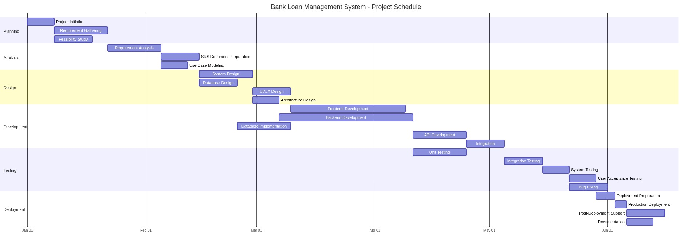

*Figure 7.1: Project Schedule Gantt Chart*

---

## 7.4 PERT Chart

The Program Evaluation and Review Technique (PERT) Chart models the precedence network of the project as a directed graph, portraying concurrent activity paths, merge nodes, and dependency links.

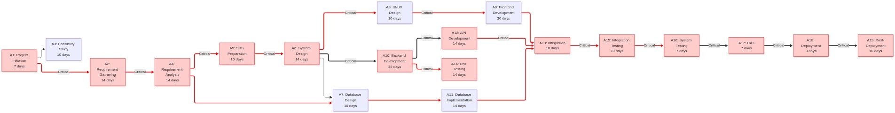

*Figure 7.2: PERT / CPM Network Diagram*

---

## 7.5 Critical Path Analysis (CPM)

Critical Path Method (CPM) is a mathematical algorithm used for scheduling project activities. The Critical Path is the sequence of dependent activities that determines the minimum total calendar duration of the project. Any delay in an activity lying on the critical path results in an immediate day-for-day delay of the entire project completion date.

### Forward Pass (Early Start and Early Finish Calculation)
* $	ext{Early Start (ES)}$: The earliest possible time an activity can commence:
  $$	ext{ES}_i = \max(	ext{EF}_{	ext{predecessors}}), \quad 	ext{ES}_{	ext{Start}} = 0$$
* $	ext{Early Finish (EF)}$: The earliest possible time an activity can conclude:
  $$	ext{EF}_i = 	ext{ES}_i + 	ext{Duration}_i$$

### Backward Pass (Late Start and Late Finish Calculation)
* $	ext{Late Finish (LF)}$: The latest possible time an activity can conclude without delaying project completion:
  $$	ext{LF}_i = \min(	ext{LS}_{	ext{successors}}), \quad 	ext{LF}_{	ext{End}} = 	ext{EF}_{	ext{End}}$$
* $	ext{Late Start (LS)}$: The latest possible time an activity can commence without delaying project completion:
  $$	ext{LS}_i = 	ext{LF}_i - 	ext{Duration}_i$$

### Total Float (Slack Time) Calculation
* $	ext{Float (Slack)} = 	ext{LS}_i - 	ext{ES}_i = 	ext{LF}_i - 	ext{EF}_i$
* An activity is **Critical** if and only if $	ext{Float} = 0$.

### Table 7.2: Critical Path Mathematical Computation Table
| Activity ID | Duration ($D$) | Predecessors | Early Start (ES) | Early Finish (EF) | Late Start (LS) | Late Finish (LF) | Total Float (Slack) | Critical? |
|---|---|---|---|---|---|---|---|---|
| **A1** | 5 | None | 0 | 5 | 0 | 5 | 0 | **YES (Critical)** |
| **A2** | 5 | A1 | 5 | 10 | 5 | 10 | 0 | **YES (Critical)** |
| **A3** | 10 | A2 | 10 | 20 | 10 | 20 | 0 | **YES (Critical)** |
| **A4** | 8 | A3 | 20 | 28 | 20 | 28 | 0 | **YES (Critical)** |
| **A5** | 7 | A4 | 28 | 35 | 28 | 35 | 0 | **YES (Critical)** |
| **A6** | 8 | A5 | 35 | 43 | 36 | 44 | 1 | No |
| **A7** | 9 | A5 | 35 | 44 | 35 | 44 | 0 | **YES (Critical)** |
| **A8** | 8 | A6, A7 | 44 | 52 | 44 | 52 | 0 | **YES (Critical)** |
| **A9** | 7 | A8 | 52 | 59 | 52 | 59 | 0 | **YES (Critical)** |
| **A10**| 7 | A9 | 59 | 66 | 59 | 66 | 0 | **YES (Critical)** |
| **A11**| 6 | A10 | 66 | 72 | 68 | 74 | 2 | No |
| **A12**| 8 | A7, A10 | 66 | 74 | 66 | 74 | 0 | **YES (Critical)** |
| **A13**| 6 | A4, A11 | 72 | 78 | 74 | 80 | 2 | No |
| **A14**| 9 | A12, A13 | 74 | 83 | 74 | 83 | 0 | **YES (Critical)** |
| **A15**| 8 | A14 | 83 | 91 | 83 | 91 | 0 | **YES (Critical)** |
| **A16**| 6 | A4, A11 | 72 | 78 | 78 | 84 | 6 | No |
| **A17**| 5 | A16 | 78 | 83 | 84 | 89 | 6 | No |
| **A18**| 4 | A17 | 83 | 87 | 89 | 93 | 6 | No |
| **A19**| 8 | A15, A18 | 91 | 99 | 91 | 99 | 0 | **YES (Critical)** |

### Identified Critical Path
$$\mathbf{	ext{Critical Path}} = \mathbf{A1 
ightarrow A2 
ightarrow A3 
ightarrow A4 
ightarrow A5 
ightarrow A7 
ightarrow A8 
ightarrow A9 
ightarrow A10 
ightarrow A12 
ightarrow A14 
ightarrow A15 
ightarrow A19}$$

* **Total Critical Duration:** $5 + 5 + 10 + 8 + 7 + 9 + 8 + 7 + 7 + 8 + 9 + 8 + 8 = \mathbf{99} 	ext{ Working Days}$ (approx. 20 calendar weeks).
* **Project Buffer:** The remaining 21 working days out of the 120-day semester schedule serve as an operational safety buffer accommodating review cycles, documentation polishing, and academic defense preparation.

---
---

# Chapter 8: Software Project Management

## 8.1 Software Development Life Cycle (SDLC) Methodology

Selecting an appropriate Software Development Life Cycle (SDLC) model is a critical managerial decision that governs process rigor, milestone verification, and risk exposure. For the **Bank Loan Management System**, the **Classical Waterfall Model with Formal Stage-Gate Verification** is selected as the primary lifecycle methodology.

### Justification for the Waterfall Model
1. **Well-Understood, Deterministic Requirements:** In commercial banking, loan approval procedures, credit appraisal criteria, and repayment accounting are governed by established legal, statutory, and institutional banking policies. Requirements are stable, deterministic, and not subject to frequent volatile shifts.
2. **High Demand for Strict Documentation:** Financial software requires comprehensive auditability. The linear stage-gate nature of the Waterfall model mandates complete, formal documentation (SRS, System Architecture, Relational Data Dictionaries, Test Suites) prior to phase advancement.
3. **Sequential Logical Dependencies:** In banking architecture, low-level database schemas and security mechanisms cannot be reliably formulated until high-level functional requirements and regulatory boundaries are fully baselined.
4. **Academic Project Alignment:** The university curriculum (CIC-357) mandates a rigorous phase-wise progression through requirement engineering, structured analysis, object-oriented design, testing, and estimation, which maps directly to the Waterfall lifecycle.

---

## 8.2 Risk Analysis and Management

Software risk management involves the proactive identification, qualitative assessment, and mitigation planning for potential threats that could derail project delivery, compromise data security, or impair functional quality.

### Table 8.1: Risk Assessment and Mitigation Matrix
| Risk ID | Risk Category | Risk Description | Probability (1-5) | Impact (1-5) | Risk Exposure ($P 	imes I$) | Mitigation Strategy | Contingency Plan |
|---|---|---|---|---|---|---|---|
| **R-01** | Technical | Unauthorized access or sensitive financial data leakage | 2 | 5 | 10 | Enforce PBKDF2 password hashing, TLS 1.3 encryption, RBAC authorization | Immediate credential revocation; audit log forensics; customer notification |
| **R-02** | Computational | Errors in mathematical EMI or interest accrual logic | 2 | 5 | 10 | Extensive unit testing; automated mathematical cross-validation against financial tables | Rollback ledger transaction; manual audit recalculation |
| **R-03** | Data Integrity | Database inconsistency during concurrent loan updates | 3 | 4 | 12 | Implement strict ACID transactions, row-level pessimistic locking, 3NF schema | Database transaction rollback; automated point-in-time recovery |
| **R-04** | Operational | Server downtime or unexpected hardware crash | 2 | 4 | 8 | Automated daily backups; redundant storage; health check daemon | Failover to hot backup replica; cloud-hosted contingency snapshot |
| **R-05** | Requirements | Regulatory policy shifts regarding lending rates | 3 | 3 | 9 | Decouple interest rates into dynamic database configuration tables | Administrative UI update of rates without recompiling software |
| **R-06** | Usability | Excessive complexity causing user submission errors | 3 | 3 | 9 | Multi-step intuitive wizard; inline format validation; comprehensive help tooltips | Customer support intervention; application draft recovery mode |
| **R-07** | Security | Upload of malicious payloads disguised as KYC documents | 3 | 4 | 12 | Strict MIME-type validation; file size caps (10 MB); file scanning | Isolate storage in quarantined sandbox; discard malicious files |
| **R-08** | Schedule | Schedule slippage due to extensive diagramming | 3 | 3 | 9 | Continuous tracking using PERT/CPM; 21-day project buffer allocation | Reallocate non-critical path floats to support critical deliverables |
| **R-09** | Quality | Inadequate test coverage overlooking edge cases | 2 | 4 | 8 | Formulate 22+ structured test cases covering EP and BVA boundary conditions | Execute secondary peer code review and regression verification |
| **R-10** | Technical | Browser incompatibility on legacy client machines | 2 | 2 | 4 | Comply with standard W3C HTML5/CSS3 rules; cross-browser polyfills | Graceful degradation to simplified standard web forms |

---

## 8.3 Software Quality Assurance (SQA)

The Software Quality Assurance (SQA) plan ensures that development processes and documentation artifacts adhere strictly to institutional standards (ISO/IEC 25010 Quality Model and IEEE Standard 730 for Software Quality Assurance Plans):

1. **Formal Technical Reviews (FTR):** Conducted at the conclusion of each major lifecycle phase:
   - *Phase 1 Review:* Requirements Completeness and Ambiguity Inspection.
   - *Phase 2 Review:* Architectural Coupling, Cohesion, and UML Consistency Audit.
   - *Phase 3 Review:* Database Normalization and Schema Integrity Audit.
   - *Phase 4 Review:* Test Case Coverage and Defect Density Review.
2. **Traceability Matrix Maintenance:** Establishes bidirectional traceability linking every user requirement (FR-001 to FR-018) to corresponding Use Cases, Class attributes, and Verification Test Cases.
3. **Coding & Documentation Standards Enforcement:** Uniform naming conventions (PascalCase for classes, camelCase for methods, UPPER_CASE for relational entities), standardized figure numbering, and explicit table labeling.

---

## 8.4 Software Maintenance Plan

Software maintenance accounts for up to 60-70% of total lifecycle software costs. The maintenance strategy defines procedures across four standard maintenance categories:

1. **Corrective Maintenance:** Addresses emergency latent defects discovered post-deployment (e.g., bug fixes for unexpected document upload format exceptions or session timeout glitches).
2. **Adaptive Maintenance:** Modifies system components to accommodate changes in external environments (e.g., updates to external credit bureau API specifications, modern browser security patch compatibility, or operating system upgrades).
3. **Perfective Maintenance:** Enhances existing functional performance and user experience based on stakeholder feedback (e.g., optimizing database query indexing to reduce dashboard loading latency from 1.5 seconds to 0.4 seconds).
4. **Preventive Maintenance:** Proactive code refactoring, database vacuuming, audit log archiving, and dependency library security patching to prevent future failures before they manifest.

---

## 8.5 Future Enhancements Roadmap

The modular architecture of the Bank Loan Management System establishes a flexible foundation for future enterprise enhancements:

1. **Artificial Intelligence / Machine Learning Credit Risk Scoring:** Integration of machine learning underwriting models (e.g., Random Forest or Gradient Boosting classifiers) trained on historical repayment datasets to predict probability of default (PD) dynamically.
2. **Automated Optical Character Recognition (OCR):** Automated extraction and parsing of textual data from uploaded Aadhaar, PAN, and salary slip PDFs, auto-populating application fields and eliminating manual data entry.
3. **Native Mobile Banking Applications:** Development of dedicated native iOS and Android client applications utilizing secure RESTful API backends.
4. **Blockchain-Enabled Immutable Audit Ledgers:** Deployment of a permissioned distributed ledger (Hyperledger Fabric) to maintain tamper-proof, cryptographically signed audit logs of all loan sanction and disbursement decisions.
5. **Aadhaar e-Sign & Digital Contract Execution:** Integration with government digital signature gateways allowing applicants to execute legally binding loan agreements digitally without paper submission.

---
---

# Chapter 9: Conclusion and References

## 9.1 Project Conclusion

The **Bank Loan Management System** project documentation presents an exhaustive, academically rigorous, and technically robust Software Engineering blueprint for automating the complete loan processing lifecycle of a modern banking enterprise.

Through systematic adherence to software engineering principles, the project has successfully accomplished:
1. Comprehensive identification of the challenges and bottlenecks inherent in manual paper-based banking operations.
2. Rigorous requirement elicitation culminating in an IEEE 830-compliant Software Requirement Specification (SRS) detailing 18 functional requirements and 8 non-functional quality attributes.
3. Complete function-oriented modeling (DFD Levels 0, 1, 2 and Structure Chart) alongside object-oriented UML modeling across 10 distinct standard diagrams (Use Case, Class, Object, State-Chart, Activity, Sequence, Collaboration, Component, and Deployment).
4. Full relational database architecture in Third Normal Form (3NF), complete with a comprehensive data dictionary, referential integrity rules, and realistic sample data records.
5. Structured verification and testing documentation comprising 22 detailed test cases grounded in Equivalence Partitioning and Boundary Value Analysis methodologies.
6. Quantitative project sizing via Albrecht / IFPUG Function Point Analysis (191.4 Adjusted Function Points) and COCOMO II effort estimation.
7. Project scheduling and tracking utilizing Work Breakdown Structures, Gantt Charts, PERT networks, and Critical Path Method (CPM) mathematical slack analysis.
8. Comprehensive project management planning encompassing Classical Waterfall justification, a 10-point risk mitigation matrix, SQA procedures, and future architectural roadmaps.

The resulting documentation provides an end-to-end engineering specification that bridges theoretical software engineering concepts and real-world enterprise banking systems.

---

## 9.2 Key Learning Outcomes

Through the conceptualization, analysis, and documentation of this project, the following core software engineering competencies and learning outcomes were attained:

1. **Requirement Engineering Competence:** Mastered the ability to translate ambiguous business operations into formal, testable, and unambiguous functional and non-functional specifications.
2. **Structured & Object-Oriented Modeling Proficiency:** Developed practical fluency in standard modeling notations (DFD, Structure Charts, UML), understanding how to maintain cross-diagram semantic consistency across structural and behavioral views.
3. **Database Architecture & Normalization Rigor:** Gained deep operational understanding of relational schema design, primary/foreign key mechanics, ACID guarantees, and the mathematical elimination of redundancy through 1NF, 2NF, and 3NF normalization.
4. **Quality Assurance & Verification Expertise:** Learned to formulate comprehensive black-box test suites, design boundary-value test cases, categorize defects by operational severity, and establish quality assurance audit gates.
5. **Project Management & Quantitative Estimation:** Developed quantitative skills in Function Point Analysis, translating user-facing functional components into software size, effort, duration, and staffing metrics, alongside network scheduling via PERT/CPM.
6. **Academic & Technical Authorship:** Refined technical writing skills to produce publication-grade engineering reports characterized by professional terminology, precise diagrammatic figures, and structured academic formatting.

---

## 9.3 System Limitations and Assumptions

### Limitations
1. **Scope Boundary:** This documentation represents a complete Software Engineering architectural and design specification; it intentionally excludes physical application source code implementation and live production deployment in accordance with the project guidelines.
2. **Simulated Verification:** Testing documentation reflects simulated verification scenarios and expected operational results rather than physical software execution logs.
3. **Simulated External Interfaces:** External interfaces (credit bureau APIs, payment gateway webhooks) are modeled conceptually based on standard industry protocols without active third-party sandbox integrations.

### Assumptions
1. Borrowers possess basic digital literacy and access to internet-enabled web client devices.
2. The banking institution operates under a secure internal network infrastructure supporting encrypted HTTPS and database cluster hosting.
3. Regulatory statutory lending rates and institutional credit guidelines remain stable across the primary development lifecycle.

---

## 9.4 Future Scope

The design specifications formulated in this project establish a comprehensive foundation for subsequent development phases:
1. **Full-Stack Physical Construction:** Transitioning the design models into physical production code utilizing modern enterprise frameworks (e.g., Spring Boot / Django backend with React / Angular presentation layers).
2. **Automated Microservices Decomposition:** Decomposing the modular three-tier architecture into containerized microservices managed via Kubernetes orchestration.
3. **FinTech Ecosystem Integration:** Direct integration with national payment architectures (UPI, NEFT/RTGS gateways) and government digital document lockers (DigiLocker) for instant automated KYC verification.

---

## 9.5 References

1. **Pressman, Roger S., and Bruce R. Maxim.** *Software Engineering: A Practitioner's Approach.* 9th Edition, McGraw-Hill Education, 2020.
2. **Sommerville, Ian.** *Software Engineering.* 10th Edition, Pearson Education, 2016.
3. **Jalote, Pankaj.** *An Integrated Approach to Software Engineering.* 3rd Edition, Springer Science & Business Media, 2005.
4. **IEEE Computer Society.** *IEEE Std 830-1998: IEEE Recommended Practice for Software Requirements Specifications.* IEEE Standards Association, 1998.
5. **IEEE Computer Society.** *IEEE Std 1016-2009: IEEE Standard for Information Technology—Systems Design—Software Design Descriptions.* IEEE Standards Association, 2009.
6. **IEEE Computer Society.** *IEEE Std 730-2014: IEEE Standard for Software Quality Assurance Processes.* IEEE Standards Association, 2014.
7. **International Organization for Standardization.** *ISO/IEC 25010:2011: Systems and Software Engineering—Systems and Software Quality Requirements and Evaluation (SQuaRE)—System and Software Quality Models.* ISO, Geneva, Switzerland, 2011.
8. **International Function Point Users Group (IFPUG).** *Function Point Counting Practices Manual (CPM).* Release 4.3.1, IFPUG, 2010.
9. **Elmasri, Ramez, and Shamkant B. Navathe.** *Fundamentals of Database Systems.* 7th Edition, Pearson, 2015.
10. **Silberschatz, Abraham, Henry F. Korth, and S. Sudarshan.** *Database System Concepts.* 7th Edition, McGraw-Hill Education, 2019.
11. **Booch, Grady, James Rumbaugh, and Ivar Jacobson.** *The Unified Modeling Language User Guide.* 2nd Edition, Addison-Wesley Professional, 2005.
12. **Fowler, Martin.** *UML Distilled: A Brief Guide to the Standard Object Modeling Language.* 3rd Edition, Addison-Wesley Professional, 2003.

---
